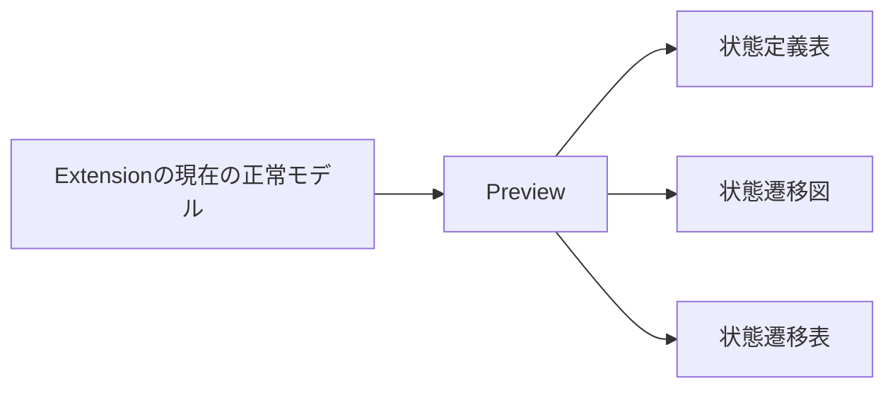

# 設計

## 背景と制約

- 提案: [proposal.md](proposal.md)
- 差分仕様: [specs/state-transition-diagram/spec.md](specs/state-transition-diagram/spec.md)
- 前提: `openspec/tech.md`のアーキテクチャ、技術上の判断基準、テスト方針と、`openspec/structure.md`の配置原則、依存方向に従う。
- 現状: `GlsModel`は状態、イベント、遷移を持ち、`targetStateId: null`と自状態のIDを区別する。\
  `Preview.tsx`は同じモデルから2表を描画し、`app/main.tsx`は通知の`sequence`で古い結果を拒否する。
- 現状: `@xyflow/react`は既存依存にあり、導入済みの型定義でノード計測、初期表示範囲、操作の制御を確認した。\
  図の描画部品と変換処理はまだない。
- 現状: 親の`useLayoutEffect`による描画完了通知だけでは、React Flowのノード計測や矢印の確定を確認できない。
- 現状: `vitest.config.ts`はWebviewの`tests/webview/**/*.test.tsx`だけを収集し、計画中の`tests/webview/state-diagram.test.ts`は収集しない。

## 設計判断

### D-01 - 3表示で同じ共通モデルを使う

- 選択: `Preview`で状態定義表、`StateDiagram`、`TransitionTable`を順に描画し、同じ`GlsModel`を渡す。\
  図の入力は有効なモデルまたは同じURIの最後の正常なモデルとし、独立したDSL解析や正常モデルのキャッシュを作らない。\
  Core、DSL、通知のモデル形式は変更しない。
- 理由: 図だけが最新または古い内容になる経路を増やさず、既存の診断、対象文書、再オープンの仕組みを利用できる。
- 代替案: Coreに図専用モデルを追加する案は、既存の状態と遷移から表示を作れるため採用しない。
- 昇格: なし。

### D-02 - IDによる状態ノードと有向ペアによる矢印

- 選択: `pages/preview/model/build-state-diagram.ts`で状態を定義順にノードへ変換する。\
  ノードIDは状態ID、表示名は`name`、表示カラーは`color`とする。\
  状態名が同じでも区別し、遷移に登場しない状態も残す。\
  遷移は`targetStateId !== null`だけを対象とし、遷移元IDと遷移先IDの順序付きペアをキーにまとめる。\
  イベントIDと処理を矢印のキーやラベルに含めない。\
  共通モデル自体と状態遷移表のイベント別セルには手を加えない。
- 理由: 同じ向きの矢印を1本にまとめる利用者の回答に従い、逆方向と自己遷移を区別する。\
  処理なしは矢印を消す理由にはならず、遷移なしは自己遷移へ置き換えない。
- 代替案: 表示名による統合とイベントごとに矢印を重ねる案は採用しない。
- 昇格: なし。

### D-03 - React Flowで通常の矢印と自己ループを描く

- 選択: `pages/preview/ui/StateDiagram.tsx`をReact Flowの入口とし、`StateNode.tsx`と`StateEdge.tsx`を図の専用部品とする。\
  `@xyflow/react/dist/style.css`は図の入口から取り込み、追加のレイアウト依存は導入しない。\
  ノードの実測した大きさと位置に応じて接続点を選び、通常の矢印を接続する。\
  相互遷移の経路は逆向きと重ならない側へ曲げる。\
  自己ループは同じノードの異なる接続点から外側を通る専用の曲線とし、終点に矢尻を置く。\
  線と矢尻は図内で共通のSVGマーカーと配色を使う。\
  マーカーIDは図のインスタンス間で衝突しないようにする。
- 理由: 通常の接続だけでは自己ループが潰れる場合があり、同じ線上の相互遷移は向きを読み取りにくい。\
  描画ライブラリの型と部品をWebviewの図の範囲へ閉じ込める。
- 代替案: 自己ループを省略する案と、図全体を独自SVGで実装する案は採用しない。
- 昇格: なし。

### D-04 - 定義順の自動配置と図に閉じたファイル配置

- 選択: 状態の定義順に左から右へ並べ、設定した列数で折り返す。\
  ノードは一定幅と最小高さを持ち、長い名前は折り返す。\
  計測後の各行の最大高さを使って次の行を配置し、名前の長さでノードが重ならないようにする。\
  ノード集合、名前による寸法、配置または図領域の寸法が変わったら、計測後に全ノードと自己ループを含む表示範囲へ合わせる。\
  処理やイベント名だけの変更では不要な再配置をしない。\
  ノードの移動、接続編集、選択、削除と選択連動を無効にする。\
  パンとホイール拡大縮小は初期案として残すが、Controls、MiniMap、操作ボタン、画像保存は追加しない。
- 理由: 保存する配置を増やさず、既存の定義順を配置の基準にできる。\
  全体の関係を読み取る基本図に範囲を絞る。
- 調整値: `pages/preview/model/diagram-config.ts`の1か所に、列数4、ノード幅160px、最小高さ64px、列間隔96px、行間隔112px、外周余白64px、自己ループの張り出し48px、相互遷移の曲げ幅28pxを定義する。\
  初期値は名前と矢印の空間を確保するためであり、テストはこの定義を参照する。
- 配置: 図の変換と配置、調整値を`pages/preview/model/`、描画部品と`diagram.css`を`pages/preview/ui/`に置く。\
  `Preview`の公開入口を維持し、図の内部部品は別の表示領域へ公開しない。
- 代替案: 外部の自動配置ライブラリ、配置のDSL拡張、編集可能な図は今回導入しない。
- 昇格: openspec/structure.md の ディレクトリ構成。

### D-05 - 指定カラーとテーマに基づく控えめな配色

- 選択: ノード名の文字色に指定カラーを使い、背景には指定カラーを薄く混ぜた色を使う初期案とする。\
  状態名はReactのテキストとして描き、HTMLへ変換しない。\
  図の基本の文字色と背景はVS Codeのテーマ変数を使う。\
  矢印の線と矢尻は同じ淡い配色を使い、イベントや遷移元の色では塗り分けない。
- 調整値: `pages/preview/ui/diagram.css`の1か所に、図の高さ360px、前景を背景へ混ぜる矢印色の比率45%、指定カラーを背景へ混ぜる比率12%をCSS変数として定義する。\
  名前の視認性と矢印の方向を保ちつつ、矢印が状態より目立たない初期値とする。\
  空状態の案内は`StateDiagram.tsx`の1か所で`状態が定義されていない。`とする。
- 理由: `openspec/tech.md`の技術上の判断基準にある控えめな背景と、利用者の淡い矢印の指定に従う。
- 代替案: 状態カラーを矢印へ流用する案と、明暗テーマによらず固定の背景を使う案は採用しない。
- 昇格: なし。

### D-06 - 図の準備完了まで含めた通知順の管理

- 選択: ExtensionのURI単位の正常モデルと版番号の後始末、Webviewの`sequence`による拒否を維持する。\
  図の準備完了を`Preview`から`PreviewRoot`へ返し、ノード計測、必要な配置と表示範囲調整、矢印の反映後に同じ通知の描画完了を送る。\
  空モデル、状態0件、正常モデルのない解析エラーはReactの表示確定後に完了とし、存在しないノードの計測を待たない。\
  新しい通知が来たら古い準備完了の処理を無効化し、URIと`sequence`が現在の通知に一致する場合だけ完了を送る。\
  正常モデルを保持したエラー表示では図と2表を同じモデルで保ち、修正時は新しいモデルへ一緒に切り替える。\
  準備完了のために固定時間の待機や通知プロトコルの新しいモデルを追加しない。
- 理由: React Flowの非同期計測前の親の描画完了だけでは、実際の図の準備を保証できない。\
  開き直しで小さくなる版番号と、古い計測完了で最新の図を置き換える問題を避ける。
- 代替案: 既存の親の`useLayoutEffect`だけを図の描画完了とする案と、図だけ別の正常モデルを保持する案は採用しない。
- 昇格: なし。

### D-07 - 意味の変換と実描画を分けて検証する

- 選択: 変換の単体テストは手で用意したノードID、名前、カラー、矢印の始点と終点の期待値を使う。\
  `vitest.config.ts`の収集対象へ`tests/webview/**/*.test.ts`を追加し、既存のCore、ExtensionとWebviewの`.test.tsx`の収集を保つ。\
  テストを先に作り、収集設定の更新後に実際のテストケースが実行され、未実装の変換で失敗することを確認する。\
  `package.json`の既存の`test`、`check:product`、`check`から追加した単体テストも実行し、検査コマンドは増やさない。\
  ブラウザテストでは実際のReact Flowを使い、図領域内のノード、SVGの経路、矢尻、自己ループの外側への張り出し、相互遷移の経路の違い、3領域の順序を確かめる。\
  DOMに矢印のIDがあるだけでは成功とせず、長さが0より大きい経路と終点のマーカーを確認する。\
  色はcomputed styleで定義元の値と照合し、線と矢尻が同じ配色であることを確認する。\
  Extensionの単体テストで対象文書と古い解析結果、正常モデルの保持と更新を、実VS Codeの統合テストで未保存の変更、診断、準備完了、再オープンを確かめる。\
  ブラウザでは同じ通知系列を実際のDOMへ適用して3表示を検証し、VS Codeのモデル通知だけで描画の検証を代用しない。
- 理由: 矢印のデータが正しくても図が描かれない場合や、古い正常モデルが条件を満たしてしまうテストを避ける。
- 誤実装の確認: 遷移なしを自己ループにする、処理なしの矢印を消す、重複をまとめない、逆方向をまとめる、自己ループを長さ0にする、淡い配色の設定を無視して矢印へ前景色を使う、図だけ古いモデルを使う、修正後も以前の正常モデルを返す、古い準備完了を受け付ける変更で対応するテストが失敗することを確認する。
- 代替案: React Flow全体のモックと、ノード数や通知されたモデルだけの検証は採用しない。
- 昇格: なし。

## 検証計画

| シナリオID | 設計判断 | 検証方法 |
| --- | --- | --- |
| REQ-014-S01 | D-01、D-02、D-03、D-04、D-05、D-07 | 自動テスト |
| REQ-014-S02 | D-02、D-03、D-07 | 自動テスト |
| REQ-014-S03 | D-02、D-03、D-07 | 自動テスト |
| REQ-014-S04 | D-01、D-06、D-07 | 自動テスト |
| REQ-014-S05 | D-03、D-05、D-07 | 自動テスト |
| REQ-015-S01 | D-02、D-03、D-07 | 自動テスト |
| REQ-015-S02 | D-02、D-07 | 自動テスト |
| REQ-015-S03 | D-02、D-07 | 自動テスト |
| REQ-015-S04 | D-02、D-03、D-07 | 自動テスト |
| REQ-015-S05 | D-02、D-03、D-07 | 自動テスト |
| REQ-016-S01 | D-03、D-05、D-07 | 自動テスト |
| REQ-016-S02 | D-05、D-07 | 実機確認 |
| REQ-017-S01 | D-01、D-02、D-06、D-07 | 自動テスト |
| REQ-017-S02 | D-01、D-06、D-07 | 自動テスト |
| REQ-017-S03 | D-01、D-06、D-07 | 自動テスト |
| REQ-017-S04 | D-01、D-06、D-07 | 自動テスト |
| REQ-017-S05 | D-01、D-06、D-07 | 自動テスト |
| REQ-017-S06 | D-01、D-06、D-07 | 自動テスト |
| REQ-017-S07 | D-03、D-06、D-07 | 自動テスト |
| REQ-017-S08 | D-01、D-06、D-07 | 自動テスト |

テーマの読みやすさは実機確認とし、具体的な手順と結果はapplyで`openspec/manual-checks.md`へ追加する。\
自動テストでは色の適用と実際の描画経路を検証し、明暗テーマでの主観的な視認性の判定を代用しない。\
DSLとCoreのモデルは変更しないため、新たな構文や参照エラーのシナリオは追加せず、既存の解析テストで互換性を確認する。\
新たな性能要件や対応環境は追加しないため、非機能要件の測定は該当しない。

apply中のタスク5.5では、OpenSpecの厳密検証と`node scripts/openspec-trace.mjs check`による通常の台帳検査を実行する。\
変更別のstrict台帳検査は未完了タスクもエラーにするため、実装タスクの完了条件には含めない。\
全タスクの完了を記録した後のverifyと、archiveの正式仕様への同期前に、`node scripts/openspec-trace.mjs check --strict --change add-basic-state-transition-diagram`を実行する。

## リスクと移行

- React Flowはコンテナ寸法とノード計測に依存する。\
  図領域の高さ、長い名前、状態0件からの追加、状態数の増減、表示領域の幅変更で計測と表示範囲を検証する。
- 自己ループや相互遷移はノードや別の矢印に隠れる可能性がある。\
  単体テストの始点と終点に加え、ブラウザで経路の形状とマーカーを確認する。
- VS CodeのCSPとビルド済みCSSで描画が欠ける可能性がある。\
  既存のローカル資産の読み込み方を維持し、実VS Codeの準備完了とテーマの実機確認で確認する。\
  CSPを検査の都合で弱めない。
- ノードの指定カラーは利用者の自由な値であり、背景との組み合わせで読みにくくなり得る。\
  淡い背景と文字色の適用箇所を調整可能にし、Dark+とLight+で確認する。
- DSL、共通モデル、通知形式の移行は不要である。\
  取り消す場合は図の描画と準備完了の連携を戻し、既存の2表の経路を保つ。
