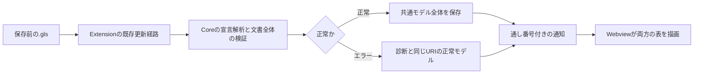

# 設計

## 背景と制約

- 提案: [proposal.md](proposal.md)
- 前提: `openspec/tech.md`のアーキテクチャ、技術上の判断基準、テスト方針と、`openspec/structure.md`の配置原則、依存方向に従う。
- 現状: `src/core/parser/parse-gls.ts`は状態宣言と意味だけを読み取り、`GlsModel`は`states`だけを持つ。
- 現状: `src/preview-protocol/index.ts`は状態だけのモデルを厳密に検証し、`Preview.tsx`は単一の状態定義表を描画する。
- 現状: ExtensionはURIごとに正常なモデルを保持し、文書の版と解析要求を照合する。\
  パネルとWebviewは再オープンをまたいで増加する`sequence`で通知の新旧を判定する。
- 制約: イベント階層、条件分岐、状態遷移図を導入せず、状態定義表の既存の列順と色セルを維持する。

## 設計判断

### D-01 - イベントと遷移を独立した宣言にする

- 選択: イベントは`Event ID as "表示名"`、遷移は`Transition 状態ID on イベントID -> 遷移先:`と4個の空白で下げた処理本文で記述する。\
  状態、イベント、遷移を任意の順に配置でき、全宣言を読んだ後に参照を解決する。\
  状態とイベントはそれぞれの宣言順を保持し、遷移の宣言順を表の行列順に使わない。
- 選択: 処理本文の単独の`-`と、遷移先の`-`でなしを明示する。\
  自状態IDへの参照と遷移なしを別に扱い、処理本文を省略することでなしを表す記法は設けない。\
  平坦な処理本文の`If READY:`などは通常の表示用テキストであり、条件として解釈しない。\
  条件分岐に見える深いインデントは診断する。
- 理由: 既存の`ID as "表示名"`とインデント本文を引き継げ、状態名やイベント名を変更しても参照を壊さずに済む。
- 代替案: 状態ブロック内へのイベントの埋め込み、イベント名による参照、空欄による暗黙の省略は、意味本文との混在や未定義との区別を増やすため採用しない。
- 昇格: なし。

```gls
State IDLE as "待機" color "#4F46E5":
    開始を待つ状態

State RUNNING as "実行中" color "#22C55E":
    実行している状態

Event START as "開始"
Event STOP as "停止"

Transition IDLE on START -> RUNNING:
    開始を記録する
    実行を準備する

Transition RUNNING on STOP -> IDLE:
    -

Transition IDLE on STOP -> -:
    -
```

この例では、STARTとRUNNINGの組み合わせだけが未定義である。\
IDLEとSTOPは処理なし、遷移なしの定義済みセルになる。\
記法と有効な入力の正本は差分仕様のREQ-007〜REQ-009とする。

### D-02 - 共通モデルを疎な遷移定義で拡張する

- 選択: `src/core/model/gls-model.ts`の`GlsModel`に、必須の`events`配列と`transitions`配列を追加する。\
  `states`と`events`は定義順を保持し、遷移は参照IDと処理を保持する。\
  処理なしと遷移なしはそれぞれ`null`に正規化し、定義のない組み合わせは`transitions`に要素を作らない。\
  状態だけの文書でも、新しい配列を空配列として返す。
- 選択: `src/preview-protocol/index.ts`の受信検証を同じ形へ拡張する。\
  イベントと遷移の項目、IDの参照、重複のない組み合わせを検証し、不正な通知を描画に採用しない。\
  通知種別、URI、版、`sequence`、準備完了と描画完了の契約は維持する。
- 理由: 両方の表が同一のモデルを使え、未定義と明示的ななしを混同せず、状態名の変更も参照から解決できる。
- 代替案: 表の全セルをCoreで埋める案、文字列`未定義`をドメイン値にする案、表ごとに別のモデルを持つ案は、表示と定義の混在や整合性の低下につながるため採用しない。
- 昇格: なし。

| 型と項目 | 内容 |
| --- | --- |
| `StateDefinition` | 既存の`id`、`name`、`meaning`、`color`を維持する |
| `EventDefinition` | `id`、`name`を持つ |
| `TransitionDefinition` | `fromStateId`、`eventId`、`action: string \| null`、`targetStateId: string \| null`を持つ |
| `GlsModel` | `states`、`events`、`transitions`のreadonly配列を持つ |

通信とCoreの型は同時に更新し、受信側に状態だけの旧通知形式を受け付ける分岐は追加しない。\
これは内部の転送形式の変更であり、既存の`.gls`ファイルの移行は必要ない。

### D-03 - 行番号を保った解析と文書全体の検証

- 選択: 既存の解析入口で宣言種別と本文の所属を判定し、元の行番号付きの状態、イベント、遷移候補を収集する。\
  状態の検証を維持し、`src/core/validator/validate-events.ts`と`validate-transitions.ts`でイベントの入力制約、参照、組み合わせの重複を検証する。\
  正常な場合だけ共通モデルを返し、1件でもエラーがあれば部分的なモデルを返さない。
- 選択: イベントIDと状態IDを別の集合で扱い、組み合わせのキーには遷移元状態IDとイベントIDを使う。\
  表示名、遷移先、処理で重複判定しない。\
  不正な構文やインデントの元の行を保持し、必須本文の不足、重複、参照の誤りは差分仕様で指定した宣言行に報告する。
- 理由: 後方参照を受け付けつつ、編集途中の不整合を正しい位置でProblemsへ示せる。
- 代替案: 宣言を読み取った瞬間に参照を解決する案と、重複を後勝ちで採用する案は採用しない。\
  新しいパーサーライブラリも追加しない。
- 昇格: なし。

### D-04 - 既存ページ内に状態遷移表を追加する

- 選択: `src/webview/pages/preview/ui/TransitionTable.tsx`に状態遷移表を置き、`Preview.tsx`から状態定義表の下に描画する。\
  両方の表に識別可能なアクセシブル名を付け、イベント名を行ヘッダ、状態名を列ヘッダとしてHTMLテーブルを作る。\
  列の状態IDと行のイベントIDから遷移を引き、遷移先名は`states`から解決する。\
  WebviewではDSLを再解析しない。
- 選択: セルには処理と遷移先を別の要素で上下に配置し、項目ラベルや遷移先の矢印を付けない。\
  なしはそれぞれ`-`にし、遷移の要素が存在しない場合だけ赤い`未定義`を1つ表示する。\
  文字列はReactのテキストとして渡し、処理は`white-space: pre-wrap`で改行を保つ。
- 選択: 状態名の文字色には検証済みの状態カラーを使い、基本の文字色、背景、横罫線は既存のVS Codeテーマ変数を使う。\
  任意のカラーを扱うためのスタイル指定は、既存のCSPを緩めずに行う。
- 理由: 現在のPages Firstの配置を維持し、状態定義表と状態遷移表を同じモデルから独立して描画できる。
- 代替案: 新しいパネルやタブ、表ライブラリ、図のライブラリは追加しない。
- 昇格: openspec/structure.md の ディレクトリ構成。

寸法と未定義の赤の調整値は`src/webview/pages/preview/ui/preview.css`の1か所に置く。\
セル余白と横罫線は既存の0.5em、1pxを再利用し、処理と遷移先の間隔は0.5em、表の領域間隔は1.5emとする。\
未定義の赤は明暗で読めるよう`--vscode-errorForeground`を使い、変数がない場合の初期値を`#d32f2f`とする。\
状態カラー自体は調整値ではなくDSLの指定値をそのまま使う。\
幅が足りない場合は状態遷移表の領域で横スクロールし、列を隠したり入れ替えたりしない。

### D-05 - 両方の表を同じ正常モデルから更新する

- 選択: Extensionは拡張した共通モデル全体を既存の通知で送り、URIごとの`lastGood`にもその全体を保持する。\
  エラー中に正常な状態だけを新しい内容へ置き換えず、診断と最後の正常な両方の表を分離する。\
  正常モデルのない別文書に切り替えた場合は、両方の表を表示不能にする。
- 選択: 既存の文書版、解析要求、`sequence`による更新判定を利用する。\
  文書を閉じる前の大きい版番号と、開き直した後の小さい版番号を直接比較する処理は加えない。\
  新しい保存監視、ポーリング、更新間隔、別の正常モデルキャッシュは追加しない。
- 理由: 保存前の変更と再オープンの経路を共通に保ち、表の片方だけが更新される不整合を防げる。
- 代替案: 表ごとの通知、Webviewで正常モデルを個別に保持する案、保存後だけの再解析は採用しない。
- 昇格: なし。



正常モデルが一度もないURIでは、Fから表示不能を通知する。\
空の有効なモデルは正常として保存し、古い行やセルを消す。

### D-06 - 空の軸と未定義セルを分ける

- 選択: 状態が0件の場合は状態の不足、状態がありイベントが0件の場合はイベントの不足を状態遷移表の領域で案内する。\
  軸がそろわない場合は表のデータ行とセルを作らず、状態定義表は既存の規則で表示する。\
  表示順と案内の優先順位は提案の未決事項に記録した暫定案とし、実装を止めない。
- 理由: 状態だけの既存文書をエラーにせず、軸自体がない状況と有効な組み合わせの定義漏れを区別できる。
- 代替案: 存在しないイベントや状態を補って`未定義`を作る案は採用しない。
- 昇格: なし。

### D-07 - 検証の境界と既存テストの維持

- 選択: Coreの単体テストで解析結果全体、定義順、明示的ななし、診断の行と理由を確認する。\
  通信の単体テストでは拡張した正常モデルと、不正な値を拒否することを確認する。\
  既存のテストデータに新しい空配列を加える場合も、元の状態と診断の期待値は維持する。
- 選択: Playwrightでは対象の表を名前で限定し、軸と各セルの内容、上下の順、ラベルの不在、文字色、未定義、テキストの改行と非実行を確認する。\
  全画面の部分一致や全文スナップショットだけで成功としない。\
  現在の状態定義表のテストも表の範囲だけを限定し、既存の期待値を弱めない。
- 選択: Extensionの単体テストで同じ正常モデルの保持、古い解析結果の拒否を確認し、VS Code統合テストで未保存文書、Problems、切り替え、実際の閉じ直しと描画完了を確認する。\
  Browser側では古い通知を拒否し、小さい版番号でも新しい`sequence`を受け付けることを確認する。
- 理由: Coreだけでは表示の入れ替えを、ブラウザーだけでは実際の文書と診断の連携を検出できないためである。
- 代替案: 実装が生成した期待値、固定時間待ちだけの更新判定、全機能を手動だけで確認する方法は採用しない。
- 昇格: なし。

既存の`check:product`と`check`の収集範囲を利用し、検査スクリプトや依存は変更しない。\
新しいVS Code統合テストは`tests/extension/suite.cjs`から同期的に呼び出す。

実装タスク内では通常のトレーサビリティ検査を行う。\
全タスクの完了を要求する`--strict --change`は、未完了タスク自身の完了条件にせず、applyで全タスクを完了した後のverifyとarchiveで実行する。

## 検証計画

| シナリオID | 設計判断 | 検証方法 |
| --- | --- | --- |
| REQ-002-S01 | D-01、D-03、D-07 | 自動テスト |
| REQ-002-S02 | D-03、D-07 | 自動テスト |
| REQ-002-S03 | D-03、D-07 | 自動テスト |
| REQ-007-S01 | D-01、D-02、D-03 | 自動テスト |
| REQ-007-S02 | D-01、D-03 | 自動テスト |
| REQ-007-S03 | D-02、D-03、D-06 | 自動テスト |
| REQ-008-S01 | D-01、D-02、D-03 | 自動テスト |
| REQ-008-S02 | D-01、D-03 | 自動テスト |
| REQ-008-S03 | D-01、D-02、D-03 | 自動テスト |
| REQ-008-S04 | D-01、D-03 | 自動テスト |
| REQ-009-S01 | D-01、D-03 | 自動テスト |
| REQ-009-S02 | D-03 | 自動テスト |
| REQ-009-S03 | D-03 | 自動テスト |
| REQ-010-S01 | D-02、D-04、D-07 | 自動テスト |
| REQ-010-S02 | D-02、D-04 | 自動テスト |
| REQ-010-S03 | D-04、D-07 | 自動テスト |
| REQ-011-S01 | D-02、D-04、D-07 | 自動テスト |
| REQ-011-S02 | D-02、D-04 | 自動テスト |
| REQ-011-S03 | D-04、D-07 | 自動テスト |
| REQ-011-S04 | D-01、D-02、D-04 | 自動テスト |
| REQ-012-S01 | D-02、D-04、D-06 | 自動テスト |
| REQ-012-S02 | D-04、D-05、D-06 | 自動テスト |
| REQ-013-S01 | D-02、D-04、D-05、D-07 | 自動テスト |
| REQ-013-S02 | D-03、D-05、D-07 | 自動テスト |
| REQ-013-S03 | D-05、D-07 | 自動テスト |
| REQ-013-S04 | D-02、D-05、D-07 | 自動テスト |
| REQ-013-S05 | D-05、D-07 | 自動テスト |
| REQ-013-S06 | D-03、D-05、D-07 | 自動テスト |

新しいシナリオはすべて自動テストとする。\
既存のテーマ実機確認REQ-004-S04は継続し、今回新たな実機確認シナリオは追加しない。\
正常系は基本の定義と各セル、境界は空の軸、表示名の重複、明示的ななし、自状態、後方参照、再オープン、異常系は構文、参照、重複、古い結果で扱う。\
イベント階層、条件分岐、図の正常系は対象外とし、未対応構文を受け付けないことだけを検証する。\
非機能要件の測定は今回追加せず、性能の数値基準は設けない。

期待値はテスト対象の解析や表示関数を使わず、入力から独立したリテラルで作る。\
調整値の色や間隔をテスト内で複写せず、定義したCSSを参照する。\
軸やセルを入れ替える、状態とイベントをソートする、なしを未定義とする、遷移先IDを表示する、参照の誤りを無視する、古い版を採用するといった誤実装をテストが検出することをverifyで確認する。

実装時の確認では、Coreの読み取りテスト12件が追加直後に失敗し、実装後に成功した。\
診断の新規テスト29件のうち、構文とインデントに関する14件は既存の解析処理で最初から成功し、不足していたID、参照、重複、処理の検証15件は失敗を確認してから実装した。\
通信契約は正常な拡張モデルの拒否と旧形式の受理をテストで検出し、画面の新規10件も実装前に失敗を確認した。\
未保存の更新、正常モデルの保持、古い結果の拒否と再オープンの追加テストは、共通モデルの拡張後に既存の汎用経路で最初から成功したため、ExtensionとWebviewの更新判定は変更していない。\
実際のVS Codeでも新規6件の統合テストが同じ経路で成功した。

## リスクと移行

- `Event START`は従来は未対応記述だったが、新しいDSLでは不足したイベント宣言になる。\
  REQ-002-S01の未対応記述の入力例を`Group STATES`に変更し、イベントの構文エラーはREQ-009-S01で検証する。\
  既存の正常な状態DSLを壊す変更はない。
- モデルの必須項目が増えるため、既存の解析結果や通知を直接組み立てるテストデータは更新が必要になる。\
  これは追加したモデル項目への対応と表の特定に限り、状態の内容、診断、順序などの期待値を実装に合わせて弱めない。
- 参照先の状態やイベントを削除すると文書がエラーになる。\
  定義を勝手に削除したり未定義セルに変換したりせず、診断と同じ文書の最後の正常な両方の表を表示する。
- 誤ったセル表示やCSPによるスタイルの欠落は、ブラウザーのCSS検証に加え、VS Codeの実際のWebviewで新しいモデルの描画が完了することを確認して対処する。\
  CSPを緩めて解消しない。
- 新しいDSLの移行処理やファイルの自動書き換えは設けない。\
  変更を戻す場合はCore、通信契約、画面、テスト、READMEとサンプルをまとめて戻す。\
  新しい宣言を含む文書は旧版では未対応になるため、利用者が追加宣言を取り除くか、この機能を含む版へ戻す。
