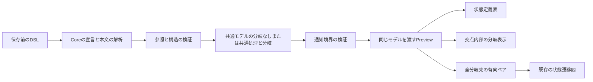

# 設計

## 背景と制約

- 提案: [proposal.md](proposal.md)
- 差分仕様: [state-transitions](specs/state-transitions/spec.md)、[state-transition-table](specs/state-transition-table/spec.md)、[state-transition-diagram](specs/state-transition-diagram/spec.md)
- 前提: `openspec/tech.md`のアーキテクチャ、技術上の判断基準、テスト方針と、`openspec/structure.md`のディレクトリ構成、配置原則に従う。
- 現状: `parse-gls.ts`は状態と単一の遷移の本文を4個の空白で読み、8個の空白を拒否する。\
  `validate-transitions.ts`は各遷移の単一の処理、遷移先と交点の重複を検証する。
- 現状: 共通モデルと通知スキーマの遷移には`action`と`targetStateId`が必須で、`TransitionTable`と`buildStateDiagram`も直接この2項目を参照する。\
  分岐を追加するだけでは、通知検証と図の変換で扱えない。
- 現状: 表は分類行の結合と見出しの対応を`build-event-rows.ts`で決め、イベントIDと状態IDで交点を求める。\
  図は有向ペアを集約し、実測と配置を終えた後に完了通知する。
- 確定: 記法と入力制約の設計を利用者から委ねられた。\
  分岐は入れ子のない1段、条件名は評価しない表示用テキストとし、専用のElse構文は設けない。

## 設計判断

### D-01 - 分岐の有無をTransitionの宣言形式で区別する

- 選択: 分岐なしの`Transition <状態ID> on <イベントID> -> <遷移先>:`は変更せず、分岐付きでは矢印と遷移先を省いた`Transition <状態ID> on <イベントID>:`を使う。\
  その下に4個の半角空白で`Common:`を最初に1回、その後に1件以上の`Branch "<条件名>" -> <遷移先>:`を並べる。\
  各ブロックの処理は8個の半角空白で始め、以降の非空行に追加のインデントを認めない。\
  空白行を無視し、複数行をLFで連結する。\
  処理がない場合も本文を省略せず、単独の`-`を必要とする。\
  分岐の遷移先は宣言済み状態のIDまたは`-`とし、分岐数に実装都合の上限は設けない。
- 選択: 条件名は引用符内の文字を保持し、空白だけ、改行と二重引用符を拒否する。\
  エスケープ、条件式の実行、既定分岐の意味は追加しない。\
  キーワードとID、引用符、矢印の間は1個以上の半角空白を必要とし、コロンは直前の要素へ続け、行末の半角空白を許可する。\
  条件名の重複は同じ遷移内だけで、大小文字と前後の空白も含む完全一致で判定する。\
  `それ以外`を先頭へ置いても最後へ動かさず、入力順で保持する。
- 理由: 既存の4個の空白の処理に含まれる`Common:`や`Branch`を、新しい構文として誤認せずに共存できる。\
  共通処理と分岐の処理を両方とも明示し、欠落と意図的ななしを区別できる。
- 代替案: 既存の処理本文の文字列から分岐を推定する案と、既存の遷移先を分岐へ暗黙に継承する案は採用しない。\
  IfとElseの実行意味や分岐の入れ子は今回の範囲に含めない。
- 昇格: なし。

```gls
EventCategoryHeaders "系統" > "区分"
Event START as "開始" in "操作" > "運転"
Transition IDLE on START:
    Common:
        要求を記録する
    Branch "準備完了" -> RUNNING:
        開始する
    Branch "それ以外" -> -:
        -
```

### D-02 - 共通モデルと宣言行を保持したCoreの解析を拡張する

- 選択: `core/model/gls-model.ts`の遷移を、分岐なしと分岐付きのunionにする。\
  分岐なしは既存の`fromStateId`、`eventId`、`action`、`targetStateId`だけの形を保つ。\
  分岐付きは`fromStateId`、`eventId`、`commonAction`、`branches`を持ち、`branches`の存在で区別する。\
  共通処理のなしは`commonAction: null`、分岐のなしは`action: null`と`targetStateId: null`でそれぞれ保持し、値を省略しない。\
  各分岐は`condition`、`action`、`targetStateId`を持ち、配列の順で表示順を表す。\
  分岐なしのモデルへ判別用の追加プロパティや空の分岐配列を付けない。
- 選択: `parse-gls.ts`で宣言の形を識別し、分岐付きブロックの行と行番号を`core/parser/parse-conditional-transition.ts`へ渡す。\
  既存の状態と分岐なし遷移のインデント処理へ入る前に、分岐付きの4個と8個の空白を区別する。\
  新しい解析関数はCommonとBranchの切り替え、必須本文、宣言順、構文の診断を担当し、元のTransition行、Common行、Branch行と本文行を候補へ保持する。\
  すべての定義を読み終えてから`validate-transitions.ts`で参照と条件名、交点の重複を検証する。\
  遷移元とイベントはTransition行、分岐の到達先はBranch行、本文不足と混在はREQ-024の規則の行へ報告する。\
  どこかに誤りがあれば文書全体のモデルをnullにし、部分的な分岐だけを返さない。
- 選択: REQ-008の本文へ分岐なしの適用範囲とREQ-023の参照を加え、REQ-009の条件分岐全体の拒否を有効記法以外の拒否へ限定する。\
  REQ-009-S01の既存のIf例は分岐なし宣言の下の未対応形式として残し、診断位置と期待値を維持する。\
  既存の状態、イベント分類とEventCategoryHeaders、遷移の前方と後方の参照を維持する。
- 理由: 共通処理と分岐の処理を混ぜず、分岐なしの既存モデルの完全一致と診断を維持できる。\
  新しい本文の構造の解析を分離し、文書全体の参照検証と表示側へ構文の知識を持ち込まない。
- 代替案: 分岐ごとに同じ交点の遷移を増やす案は既存の重複禁止と衝突するため採用しない。\
  分岐先を平坦な`targetStateId`にも複写する案は情報源が二重になるため採用しない。
- 昇格: なし。

### D-03 - 通知境界で両形式と全分岐の整合を検証する

- 選択: `preview-protocol/index.ts`の遷移スキーマを、既存の厳密オブジェクトと、D-02の分岐付き厳密オブジェクトのunionへ広げる。\
  `commonAction`と各`action`は非空白文字列またはnull、`branches`は1件以上の配列とする。\
  条件名は非空白の文字列で改行と二重引用符を拒否し、各分岐も厳密オブジェクトとする。\
  値の欠落、型違い、空配列、条件名の重複、余分な入れ子や平坦な項目の混在を拒否する。\
  文書全体のrefineで、すべての分岐先のID形式と宣言済み状態への参照、共通の交点の一意性を検証する。\
  分類と列見出し、状態、URI、version、sequenceの検証は維持する。\
  不正な値を分岐なしへ変換したり、既定値で補完したりしない。
- 理由: Coreからの正常な新形式を受け付け、Webviewが描画不能なモデルや混在する形式で正常表示を失うことを防げる。
- 代替案: 任意のプロパティを通す案、最初の分岐だけを検証する案、WebviewでDSLを再解析する案は採用しない。
- 昇格: なし。

### D-04 - 分岐セルの内側だけを横方向へ分割する

- 選択: `TransitionTable.tsx`は交点のtdとheadersの対応、既存の行モデルを保ち、分岐付きの場合だけ同じui配下の`ConditionalTransitionCell.tsx`へセル内部を渡す。\
  共通処理の領域を先に1個、その下に分岐の数の列を持つCSS Gridを置く。\
  各分岐は条件名、処理、遷移先の状態名の順の3領域とし、状態名は既存と同じIDのMapから求める。\
  共通処理と分岐の間に項目ラベルを付けず、各なしを`-`にする。\
  分岐のキーにはその遷移内で一意な条件名を使い、並べ替えで内容を別の条件へ付け替えない。\
  行や状態列を分岐数へ展開せず、分岐なしの上下2段と未定義の描画経路を保つ。
- 選択: `preview.css`で2番目以降の分岐の左辺だけへ縦線を引き、共通処理とtd全体、分類領域へ縦線を付けない。\
  1分岐には内部の縦線を作らない。\
  共通処理、条件名、分岐の処理と遷移先はReactの文字列として表示し、pre-wrapとoverflow-wrapを使って折り返す。\
  分岐列は`minmax(0, 1fr)`で並べ、省略や内容の切り取りをしない。\
  横スクロールは既存の`transition-scroll`を利用する。
- 調整値: 各領域の間隔と分岐の余白には既存の`--transition-line-gap: 0.5em`を共用する。\
  縦線の太さは新しい`--transition-branch-line-width: 1px`として`preview.css`の`.transition-section`に1か所だけ定義し、既存と同じ`--vscode-panel-border`を色に使う。\
  テストは太さと余白をこの定義から参照し、縦線が存在することと適用範囲を検証する。
- 理由: 条件ごとに比較でき、共通処理が分断されず、分類のrowSpanとcolSpan、イベントと状態の交点をそのまま利用できる。
- 代替案: tdそのもののcolSpanや状態列の増加、共通処理を各分岐へ複写する表示、全セルを上下の表へ分ける案は採用しない。
- 昇格: なし。

### D-05 - 全到達先を既存の有向ペアへ集約する

- 選択: `build-state-diagram.ts`で、分岐なしは既存の遷移先1件、分岐付きはすべての`branches[].targetStateId`を列挙する。\
  nullを除き、既存の`fromStateId:targetStateId`のMapへ同じ形式のEdgeを登録する。\
  共通処理や分岐の処理の有無を矢印の条件にせず、同じ到達先の分岐と別イベント、分岐なしの遷移も1本にまとめる。\
  自己ループと逆方向、矢尻の向き、淡い配色は既存のStateDiagramとStateEdgeへ任せる。\
  条件ノードや条件ラベルを追加せず、CoreにReact Flowの型を入れない。
- 理由: すべての到達可能な状態を図へ反映し、既存の関係の集約と描画を再利用できる。
- 代替案: 先頭分岐だけを使う案、処理のない分岐を除く案、分岐ごとに別の矢印を重ねる案は採用しない。
- 昇格: なし。

### D-06 - 同じ正常モデルと図を含む完了通知を利用する

- 選択: 既存の`extension.ts`と`preview-panel.ts`によるURIごとのlastGood、診断、再オープンの後始末、revisionとsequenceを利用する。\
  分岐専用の正常モデルや通知経路は追加しない。\
  同じGlsModelを3表示へ渡し、分岐のエラーでも直前の正常モデルを使い、修正後は必ず現在のモデルへ置き換える。\
  Coreと境界、表と図への接続後に既存経路の不足が判明した場合だけ、該当する既存モジュールを修正する。
- 選択: 共通処理と条件名、分岐の処理だけの編集では状態ノードと有向ペアが変わらないため、既存の図のidentityと完了通知を維持する。\
  到達先が変われば既存の図の配置と計測を経て、両表と現在の図の準備完了を通知する。\
  以前の図の準備完了や小さい版番号の拒否を、分岐専用の判定へ置き換えない。
- 理由: 分岐を同じ文書の設計情報として扱い、エラー回復後に古い正常モデルを返し続ける経路を増やさない。
- 代替案: 表だけで先に完了する案、versionだけで通知順を判定する案、分岐ごとのキャッシュは採用しない。
- 昇格: なし。



### D-07 - 実際のセルの境界とすべての到達先を検証する

- 選択: Coreと通信境界の期待値は手で用意し、対象の解析や変換から生成しない。\
  既存の分岐なしと分類のテストの期待値を変えず、矢印付き宣言の本文にある予約語も文字列として保持する。\
  新しい本文構造、なし、順序、診断行、同名条件の範囲、交点の重複を独立した判断と境界の例で確認する。\
  最初から既存経路で成功するテストは、その理由を記録する。
- 選択: ブラウザでは文字列だけでなく、共通処理と分岐群の上下位置、各分岐の左右位置、領域ごとの縦線のcomputed styleと実座標を確認する。\
  共通処理の出現回数、1分岐と3分岐、分岐なしと未定義が混在する行、分類の結合と不足段の空欄、状態列の横位置、IDごとに異なる全交点の内容を検証する。\
  図はEdgeのIDだけで済ませず、各実経路の始点と終点、長さ、矢尻の実際の向き、自己ループと逆方向を確認する。\
  既存の矢尻と経路終端の進行方向の照合方法を利用する。
- 選択: Extensionの単体と実VS Codeで、保存前の更新、エラーの保持、異なる現在の共通処理と条件と処理と遷移先と状態名と分類への回復、宣言行の診断と消去を確認する。\
  ブラウザでも同じ系列を3表示へ適用し、正常モデルの通知だけで実描画を代用しない。\
  再オープンは自動更新とコマンド再実行を別々に確認し、両方で閉じる前より小さい版番号をassertする。\
  準備中の更新は実際の図の計測を制御し、古い完了通知と現在の完了通知を区別する。
- 選択: 一時コピーに、共通処理の破棄または各分岐への複写、先頭分岐だけの保持、順序の並べ替え、なしの自己遷移化、条件名の全遷移での重複禁止、分岐ごとの交点重複の許可、不正な境界通知の受理、セル全体の縦分割、1分岐の余分な列、分類や状態列のずれ、図の2分岐目の省略と重複、180度に固定した矢尻、古い正常モデルの固定、古い通知の受理を単独で入れる。\
  対応シナリオのassertで失敗することと、元の実装へ戻した成功を記録する。\
  境界の不正モデルは対象項目だけを壊し、すべてのID参照など他の条件は有効にして、別の検証による拒否で誤りを隠さない。
- 理由: 条件名や到達先の文字列がどこかにあるだけでは、共通処理の分断、交点のずれ、欠けた矢印と修正後も古いモデルを返す誤りを見逃す。
- 代替案: スナップショットだけ、既存テストの期待値の緩和、図の完了を待たない通知検査は採用しない。
- 昇格: なし。

## 検証計画

| シナリオID | 設計判断 | 検証方法 |
| --- | --- | --- |
| REQ-008-S01 | D-01、D-02、D-07 | 自動テスト |
| REQ-008-S02 | D-01、D-02、D-07 | 自動テスト |
| REQ-008-S03 | D-01、D-02、D-07 | 自動テスト |
| REQ-008-S04 | D-01、D-02、D-07 | 自動テスト |
| REQ-009-S01 | D-01、D-02、D-07 | 自動テスト |
| REQ-009-S02 | D-01、D-02、D-07 | 自動テスト |
| REQ-009-S03 | D-01、D-02、D-07 | 自動テスト |
| REQ-011-S01 | D-04、D-07 | 自動テスト |
| REQ-011-S02 | D-04、D-07 | 自動テスト |
| REQ-011-S03 | D-04、D-07 | 自動テスト |
| REQ-011-S04 | D-04、D-07 | 自動テスト |
| REQ-015-S01 | D-05、D-07 | 自動テスト |
| REQ-015-S02 | D-05、D-07 | 自動テスト |
| REQ-015-S03 | D-05、D-07 | 自動テスト |
| REQ-015-S04 | D-05、D-07 | 自動テスト |
| REQ-015-S05 | D-05、D-07 | 自動テスト |
| REQ-023-S01 | D-01、D-02、D-03、D-07 | 自動テスト |
| REQ-023-S02 | D-01、D-02、D-03、D-07 | 自動テスト |
| REQ-023-S03 | D-01、D-02、D-03、D-07 | 自動テスト |
| REQ-023-S04 | D-01、D-02、D-03、D-07 | 自動テスト |
| REQ-024-S01 | D-01、D-02、D-03、D-07 | 自動テスト |
| REQ-024-S02 | D-01、D-02、D-03、D-07 | 自動テスト |
| REQ-024-S03 | D-01、D-02、D-03、D-07 | 自動テスト |
| REQ-024-S04 | D-01、D-02、D-03、D-07 | 自動テスト |
| REQ-025-S01 | D-03、D-04、D-07 | 自動テスト |
| REQ-025-S02 | D-03、D-04、D-07 | 自動テスト |
| REQ-025-S03 | D-03、D-04、D-07 | 自動テスト |
| REQ-025-S04 | D-03、D-04、D-07 | 自動テスト |
| REQ-025-S05 | D-03、D-04、D-07 | 自動テスト |
| REQ-026-S01 | D-03、D-05、D-07 | 自動テスト |
| REQ-026-S02 | D-03、D-05、D-07 | 自動テスト |
| REQ-026-S03 | D-03、D-05、D-07 | 自動テスト |
| REQ-027-S01 | D-02、D-03、D-04、D-05、D-06、D-07 | 自動テスト |
| REQ-027-S02 | D-02、D-03、D-04、D-05、D-06、D-07 | 自動テスト |
| REQ-027-S03 | D-02、D-03、D-04、D-05、D-06、D-07 | 自動テスト |
| REQ-027-S04 | D-02、D-03、D-04、D-05、D-06、D-07 | 自動テスト |
| REQ-027-S05 | D-02、D-03、D-04、D-05、D-06、D-07 | 自動テスト |
| REQ-027-S06 | D-02、D-03、D-04、D-05、D-06、D-07 | 自動テスト |

分類と分岐の構造、境界と文字列、矢尻と経路は自動で判定できるため、新しい実機確認は追加しない。\
既存の明暗テーマの確認は`openspec/manual-checks.md`の結果を維持し、今回の自動テストで確認済みにしない。\
性能と対応環境の約束は変更しないため、新しい非機能要件の測定は該当しない。\
REQ-008、REQ-009、REQ-011、REQ-015の既存シナリオを維持し、分類と列見出しのREQ-018からREQ-022も既存の自動テストで回帰確認する。

## リスクと移行

- 旧形式の処理の中にあるCommonやBranchの文字列を構文として読み取ると互換性を壊す。\
  Transition行の形式で先に区別し、旧本文の完全一致を回帰確認する。
- 分岐先の参照の診断をTransition行へ寄せると修正箇所が分かりにくい。\
  Branch行と本文行を候補の内部だけに保ち、各診断の元の行をassertする。
- セル全体や状態列を分岐数へ分割すると、共通処理と分類の結合が崩れる。\
  交点のtdは保持し、共通処理と分岐群の実座標と縦線の適用範囲を検証する。
- 不正なunionを境界が受理したり、図が最初の分岐しか見ない場合に表と図が食い違う。\
  境界で全分岐の参照を検証し、2番目以降が異なる状態へ向かう図を実描画で確認する。
- 既存DSLの移行は不要で、同じ文書に両形式を混在できる。\
  旧版へ戻す場合は分岐を単一遷移へ明示的に書き換える必要があり、自動変換は行わない。\
  正式仕様はアーカイブ時に同期し、今回対象外の要件と既存のPurposeを保持する。
