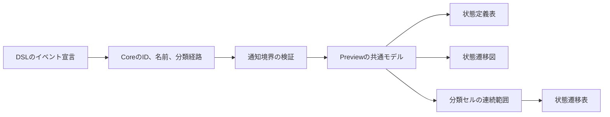

# 設計

## 背景と制約

- 提案: [proposal.md](proposal.md)
- 差分仕様: [state-transitions](specs/state-transitions/spec.md)、[state-transition-table](specs/state-transition-table/spec.md)
- 前提: `openspec/tech.md`のアーキテクチャ、技術上の判断基準、テスト方針と、`openspec/structure.md`の配置原則、依存方向に従う。
- 現状: `parse-gls.ts`は行ごとの宣言を解析し、イベントはIDと名前だけを持つ。\
  下げたイベント宣言は`event-hierarchy`の診断となり、分類の記法はない。
- 現状: 通知のイベントは`z.strictObject`で検証するため、Coreだけに分類を追加してもWebviewで拒否される。
- 現状: `TransitionTable`はイベントごとに1行を描き、イベントIDと状態IDでセルを決める。\
  `Preview`は同じモデルを3表示へ渡し、ExtensionはURIごとの正常モデルと診断を管理する。
- 確定: 最大3段は分類だけの段数とし、その下のイベント名は数えない。\
  記法と入力制約は今回設計する。

## 設計判断

### D-01 - 既存のイベント宣言へ分類経路を任意で付ける

- 選択: 末尾へ`in "<分類名>" > "<分類名>" > "<分類名>"`を任意で付け、1段から3段を指定する。\
  分類名の引用符と非空の制約はイベント名と同じとし、引用符内の`>`は名前の一部として保持する。\
  引用符内の空白も保持し、空白だけの名前は拒否する。\
  引用符のエスケープは導入しない。\
  キーワードと引用符の間は半角空白1個以上、`>`の前後は半角空白0個以上とし、行末の半角空白を許可する。\
  行頭のインデントとイベント宣言自体の入れ子は許可しない。
- 選択: `EventDefinition`へ`readonly categoryPath?: readonly string[]`を追加する。\
  分類なしにはプロパティを付けず、既存のモデルの完全一致と通知を維持する。\
  分類付きだけに、祖先から子の順の非空配列を持たせる。\
  `parse-gls.ts`で引用符と区切りを末尾まで読み、`validate-events.ts`で名前と段数を検証する。\
  単純な`split(">")`や途中までの読み取りは使わず、分類の構文、名前、深さの理由を宣言行で報告する。\
  深さの診断には上限3を示す。
- 選択: イベントIDは従来どおり文書全体で一意とし、分類の名前空間や独立した分類宣言は追加しない。\
  遷移の参照検証はイベントIDの集合をそのまま使う。
- 理由: 既存DSLと共存でき、分類の移動で遷移を書き換える必要がない。\
  REQ-007とREQ-009の既存シナリオを保ち、禁止する階層をイベント宣言自体の入れ子に限定できる。
- 代替案: 分類ブロックの入れ子はインデント規則を増やすため採用しない。\
  分類を区切り付きの1文字列で持つ案は、名前と区切りの混同を避けるため採用しない。
- 昇格: なし。

```gls
Event START as "開始" in "操作" > "運転" > "開始系"
Event STOP as "停止" in "操作" > "運転"
Event PING as "疎通確認"
```

### D-02 - 通知境界でも任意の経路を検証する

- 選択: `preview-protocol/index.ts`の厳密スキーマへ任意の`categoryPath`を追加する。\
  省略を受け付け、存在する場合は長さ1から3、各要素が空白だけではない文字列で、改行と二重引用符を含まないことを検証する。\
  空配列、4段、null、配列以外と不正な要素を拒否し、受信モデルを補完しない。\
  IDと参照、URI、version、sequenceの既存契約を維持する。
- 理由: Coreの分類をそのまま伝え、不正な分類通知で現在の正常表示を壊さない。
- 代替案: 境界検証を緩める案と、Webviewで分類DSLを再解析する案は採用しない。
- 昇格: なし。

### D-03 - 宣言順と連続範囲に基づいて分類セルを作る

- 選択: `pages/preview/model/build-event-rows.ts`に、最大深さと各行の分類セルを作る純粋な変換を追加する。\
  最大深さを`d`とし、分類領域を`d`列、イベント名をその右の1列にする。\
  分類なしだけなら`d = 0`で既存の表構成となる。\
  同一性はその段までの名前の配列の完全一致で決め、区切りで連結した文字列をキーにしない。\
  連続する共通の経路の先頭行だけに分類セルと`rowSpan`を返し、別の経路や分類なしを挟んだら結合を切る。\
  浅い分類の不足分は行ごとの空セルの`colSpan`で表し、空欄は行をまたいで結合しない。\
  イベント行の順序とIDは入力のままとし、分類だけの行は作らない。
- 選択: `TransitionTable.tsx`は分類とイベント名の上に、既存の`イベント`の見出しを`colSpan = d + 1`で表示する。\
  段ごとの固定見出しと空欄への補完名は付けない。\
  分類名はReactの文字列で描き、分類セル、イベントと状態の見出しに一意なIDを付け、データセルの`headers`で対応を明示する。\
  処理と遷移先の描画、状態カラーは維持する。
- 理由: 宣言順を保って祖先関係を読み取れ、深さが混在しても状態列がずれない。\
  同名の子と離れた分類を結合せず、分類を取り除けば従来の表へ戻る。
- 調整値: 新しい余白や固定幅は導入せず、`pages/preview/ui/preview.css`の既存の表セルの余白`0.5em`とテーマの横罫線を共用する。\
  分類名は折り返し、表の既存の横スクロール領域を使う。
- 配置: `pages/preview/model/`の説明を図と表の変換へ広げる。\
  新しいディレクトリや分類専用のストアは作らない。
- 代替案: 分類順のソート、子の名前だけによる結合、常に3列を空ける表示は採用しない。
- 昇格: openspec/structure.md の ディレクトリ構成。



### D-04 - 現在の正常モデルと既存の完了通知を利用する

- 選択: 分類のためのキャッシュや図のモデルを追加せず、既存の`lastGood`と同じ`GlsModel`を3表示へ渡す。\
  分類の誤りでも既存経路で診断とエラー案内を出し、3表示を保持する。\
  修正後は新しいモデルへ切り替える。\
  分類だけの変更では図のノードと有向ペアは同じなので、不要な再配置をしない。\
  描画完了は図の準備完了を含む既存通知を使い、表だけの先行した完了にはしない。\
  対象URI、古い通知の拒否と再オープンの後始末を維持する。
- 理由: 既存の3表示の整合と再オープンの修正を利用し、分類だけ古いモデルを使う経路を増やさない。
- 代替案: 分類専用の正常モデルと、文書のversionだけによる完了判定は採用しない。
- 昇格: なし。

### D-05 - 変換と実際の表、実VS Codeの経路を検証する

- 選択: Coreで分類なし、1段、2段、上限3段、超過4段と構文、名前、ID重複を確認する。\
  境界の通知と行変換の期待値は手で用意し、対象の関数から生成しない。\
  ブラウザでは実際の分類セルの`rowSpan`と`colSpan`、イベント行、状態列の実座標と処理を照合する。\
  最大深さ3段の混在例で、浅い行のイベント名と状態列が深い行と同じ横位置になることを確認する。
- 選択: Extensionの単体と実VS Codeで、未保存編集、宣言行の診断、正常表示からエラー保持を経て異なる内容へ修正する流れ、文書切り替え、再オープンを確認する。\
  ブラウザでも同じ通知系列を3表示へ適用する。\
  回復後の分類、状態名、処理、遷移先を以前と異ならせ、図のノードと終点、両方の表、診断と案内の消去を確認する。\
  再オープンは版番号の大小をassertし、自動更新とコマンド再実行を別々に確認する。\
  既存経路で最初から成功するテストは理由を記録する。
- 選択: 一時コピーで、4段目の切り捨て、分類の破棄、分類別のID重複許可、子の名前だけの結合、離れた経路の結合や並べ替え、空欄欠落による列ずれ、固定分類名、修正後も古い正常モデル、古い通知の受理を単独で入れ、対応テストが失敗することを確認する。\
  既存の分類なしDSLのテストは期待値を変えずに成功させる。
- 理由: 分類文字列がどこかにあるだけの検査では、所属や交点のずれと古い正常表示を返し続ける誤りを見逃す。
- 代替案: スナップショットだけや、通知モデルだけで実描画を代用する案は採用しない。
- 昇格: なし。

## 検証計画

| シナリオID | 設計判断 | 検証方法 |
| --- | --- | --- |
| REQ-007-S01 | D-01、D-02、D-05 | 自動テスト |
| REQ-007-S02 | D-01、D-05 | 自動テスト |
| REQ-007-S03 | D-01、D-02、D-05 | 自動テスト |
| REQ-009-S01 | D-01、D-05 | 自動テスト |
| REQ-009-S02 | D-01、D-05 | 自動テスト |
| REQ-009-S03 | D-01、D-05 | 自動テスト |
| REQ-018-S01 | D-01、D-02、D-05 | 自動テスト |
| REQ-018-S02 | D-01、D-03、D-05 | 自動テスト |
| REQ-018-S03 | D-01、D-04、D-05 | 自動テスト |
| REQ-019-S01 | D-01、D-02、D-05 | 自動テスト |
| REQ-019-S02 | D-01、D-02、D-05 | 自動テスト |
| REQ-020-S01 | D-02、D-03、D-05 | 自動テスト |
| REQ-020-S02 | D-03、D-05 | 自動テスト |
| REQ-020-S03 | D-03、D-05 | 自動テスト |
| REQ-020-S04 | D-03、D-05 | 自動テスト |
| REQ-020-S05 | D-01、D-02、D-03、D-05 | 自動テスト |
| REQ-021-S01 | D-01、D-03、D-04、D-05 | 自動テスト |
| REQ-021-S02 | D-01、D-03、D-04、D-05 | 自動テスト |
| REQ-021-S03 | D-02、D-04、D-05 | 自動テスト |
| REQ-021-S04 | D-02、D-04、D-05 | 自動テスト |
| REQ-021-S05 | D-01、D-04、D-05 | 自動テスト |

分類セルの配置と文字列は自動で確認でき、新しい配色や主観的な視認性の約束は追加しないため、実機確認の追加はない。\
既存の明暗テーマの実機確認は`openspec/manual-checks.md`で扱う。\
性能と対応環境は変更しないため、非機能要件の測定は該当しない。\
REQ-008、REQ-010からREQ-017は変更せず、既存テストで処理と遷移先、空の軸、図、正常表示の保持と完了通知を回帰確認する。

## リスクと移行

- 引用符内の`>`や分類名に含まれる区切りと、経路の区切りを混同する可能性がある。\
  Coreでは引用符ごとに読み、表示の結合は名前の配列の共通部分で決める。
- 結合済みの分類セルや空欄を数え違えると、イベントと状態の交点がずれる。\
  行変換の単体と、実座標と各行の異なる処理の照合を組み合わせる。
- 通知検証だけが古いと、分類付きの正常なモデルが拒否される。\
  Core、通知境界、Webviewを同じ変更で更新し、実VS Codeの描画完了まで確認する。
- 既存DSLや保存データの移行は不要で、任意の分類経路の追加から利用できる。\
  旧版へ戻す場合は`in`以降を除けば既存イベントになり、イベントIDと遷移は変更しない。\
  正式仕様はアーカイブ時に同期し、既存のPurposeと今回触れない要件を保持する。
