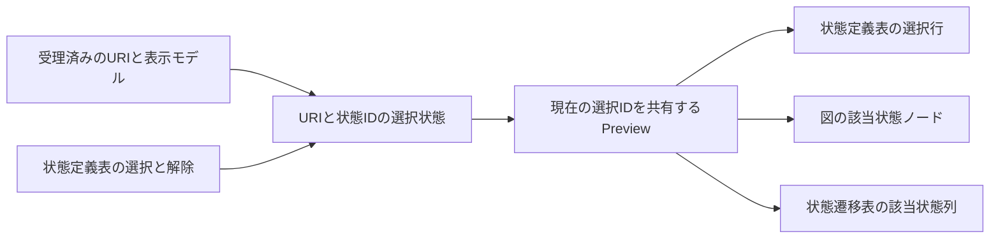

# 設計

## 背景と制約

- 提案: [proposal.md](proposal.md)
- 差分仕様: [state-definition-preview](specs/state-definition-preview/spec.md)、[state-transition-diagram](specs/state-transition-diagram/spec.md)、[state-transition-table](specs/state-transition-table/spec.md)
- 前提: `openspec/tech.md`のアーキテクチャ、技術上の判断基準、テスト方針と、`openspec/structure.md`のディレクトリ構成、依存方向に従う。
- 現状: `Preview.tsx`が状態定義表、StateDiagram、TransitionTableを同じモデルから表示し、選択状態と行操作は持たない。\
  `main.tsx`は通知形式とsequenceを検証してから最新の通知を描画し、URIはPreviewRootまでで、Previewへは渡していない。
- 現状: 図の状態ノードは指定カラーを混ぜた背景を持ち、React Flowの選択操作は無効である。\
  グループ枠と所属状態の座標、グラフidentity、計測とviewportは描画完了と結び付いている。
- 現状: TransitionTableは状態IDとイベントIDで交点を決め、分類セルの後に状態セルを表示する。\
  DOM上の列番号は分類深さとrowSpanに影響されるため、列番号から状態を推定できない。
- 確定: 強調は選択行、状態ノード、状態列全体だけとし、同一文書の状態IDが残る限り選択を保持する。\
  解析エラー中は正常表示と選択を保持し、IDの消失と文書切替で解除する。
- 確定: 単一選択、再選択とEscapeでの解除、マウスとキーボードによる操作の設計を利用者が委ねた。\
  依存は既存のReactとZustandを使い、DSLとCore、Extensionの通知契約は変更しない。

## 設計判断

### D-01 - 状態名の操作対象と行クリックで同じ選択を操作する

- 選択: 状態定義表の状態名をtype=buttonのネイティブ操作対象とし、aria-pressedで選択状態を示す。\
  行内の色、名前、意味のクリックを1つの選択操作にまとめ、別行は切替、同じIDは解除とする。\
  buttonから行へのイベント伝播で2回反転させず、EnterとSpaceはネイティブ操作のclickへ統合する。
- 選択: Preview内のEscapeで選択を解除する。\
  状態名の操作対象はTabで到達でき、フォーカスの移動だけでは選択を変えず、focus-visibleは下線で示す。\
  色、状態、意味の3列とテキスト、色見本、意味の改行は保ち、追加の選択列と選択を示す枠線を作らない。
- 理由: マウスの行操作とキーボードの起動を同じ動作へ接続でき、表の構造をグリッドへ変更せず支援技術へ状態を伝えられる。
- 代替案: trだけのclick、独自のキー操作を持つグリッド、選択用チェック列は採用しない。
- 昇格: なし。

### D-02 - 受理した通知のURIと状態IDで選択を整合する

- 選択: `pages/preview/model/state-selection.ts`へZustandのストア生成と選択、解除、通知との整合の操作を置く。\
  選択はURIとstateIdの組だけとし、文書別の履歴とCoreモデルの複製を持たない。\
  Webview内で1インスタンスを使用し、テストでは生成関数から独立したストアを作る。
- 選択: 必要な整合操作を`pages/preview/index.ts`から公開し、`app/main.tsx`では既存の形式とsequenceの拒否判定を通過した通知だけに適用する。\
  URI変更、model=null、選択IDの消失でstateIdを消す。\
  同じURIと同じIDが残る場合はhasErrorsとversionの値で消さず、後の再追加や対象文書への復帰で復元しない。
- 選択: `PreviewRoot`からPreviewへdocumentUriを渡し、Previewが現在のURIと表示モデルのID集合で有効な選択だけを読み、子へselectedStateIdを渡す。\
  不適合な選択を描画後のuseEffectだけで消す構成にせず、古い文書の行のイベントから新しいURIの状態を選ばない。\
  エラー時はExtensionが渡す同じURIのlastGoodを表示モデルとして利用し、エラー中の操作も表示中のIDに対して適用する。
- 選択: Webviewのモジュールを新しく起動したら未選択とし、VS CodeのsetStateや永続ストレージへ選択を書かない。\
  選択操作だけではDSL、診断、通知番号を変更せず、新しい解析要求や独自の完了通知を作らない。
- 理由: IDに基づく保持、文書境界と通知拒否を1か所へ集め、3表示で異なる選択を持つことと、削除したIDの選択の復活を防ぐ。
- 代替案: 名前や配列位置での保持、URI別Mapへの保存、モデルの選択項目追加、解析エラーを理由にする無条件解除は採用しない。
- 昇格: なし。

### D-03 - 共通の薄い背景と下線で選択とフォーカスを区別する

- 選択: `preview.css`のPreviewルートに、選択のアクセント色、混合率、フォーカス下線の調整値を1か所だけ定義する。\
  アクセントは`--vscode-list-activeSelectionBackground`を優先し、未設定なら`--vscode-foreground`、さらに未設定なら既存の図と同じ基本文字色を使う。\
  選択背景の混合率の初期値は18%とし、残りを表示領域の通常の背景と混ぜる。\
  フォーカス下線の初期値は太さ1px、間隔0.15emとし、文字と区別できて寸法を変えないために使う。
- 選択: 行と列は通常のエディター背景、ノードは指定カラーを既存の割合で混ぜた通常背景を混合先にする。\
  同じ選択IDの対象へdata属性または専用クラスを付け、選択前後の背景の差を出す。\
  選択によるborder、outline、box-shadowを追加せず、名前の文字色、色見本、未定義の文字色と、既存の罫線、分岐の縦線、グループ枠を変えない。
- 選択: 操作対象のbuttonは文字とフォントを継承し、通常のボタン背景と枠を付けない。\
  キーボードフォーカスは下線で残し、outlineを使わなくてもフォーカス位置を見失わないようにする。
- 理由: 選択の面積を示しつつ、状態カラーや未定義の意味を隠さず、線が持つ既存の役割を保てる。
- 代替案: 状態カラーの強い塗りつぶし、選択用の外枠や影、フォーカス表示の消去は採用しない。
- 昇格: なし。

### D-04 - ノードの表示だけに選択を重ねる

- 選択: `StateDiagram.tsx`へselectedStateIdを渡し、状態ノードの描画データに表示用の選択を重ねて`StateNode.tsx`へ渡す。\
  `buildStateDiagram`の有向ペア、グループ化とgraph identity、レイアウト用のノード列はモデル由来のままにし、React Flowのselectedとユーザーによる選択機能を使わない。
- 選択: 選択を反映したノード列は、座標と計測、viewportを計算するノード列から分ける。\
  選択IDをReactFlowProviderのkeyやfit処理、layoutKeyの要素に加えず、色以外の寸法を変えない。\
  既存の描画完了はURIとsequenceに対応する図の準備を待ち、選択の切替だけで再配置や追加の完了通知を起こさない。
- 選択: state型のノードIDだけを比較し、グループのparentId、グループ名、状態名、Edgeのsourceとtargetで選択を広げない。\
  `state-group:A`と状態Aを区別し、枠と矢印、接続先の背景は通常のままにする。
- 理由: 1状態の見比べの操作が図全体の再計測や表示位置の変更にならず、集約された矢印を選択状態だけの遷移と誤認させない。
- 代替案: React Flowの組み込み選択、選択IDを含めたグラフの再生成、所属グループと接続先への一括強調は採用しない。
- 昇格: なし。

### D-05 - 状態列の見出しと交点へ同じIDの表示を適用する

- 選択: `TransitionTable.tsx`へselectedStateIdを渡し、states.mapで見出しと各行のtdを作る位置でstate.idを比較する。\
  DOMのnth-childや分類深さから列を決めず、分岐なし、未定義、分岐付きのすべての交点で同じtd全体に選択背景を付ける。
- 選択: 共通処理と分岐の内側は背景を追加せず、親セルの選択背景を見せる。\
  分類とイベントのth、空欄のtd、他列のtransition-targetとbranch-targetを強調しない。\
  表がない場合は既存の不足案内を保ち、選択用の列やセルを補わない。
- 理由: 分類のrowSpanと不足段のcolSpan、分岐数に影響されず、遷移元状態としての列だけを追える。
- 代替案: 表示名による比較、固定の列番号、遷移先IDが一致する他セルの強調は採用しない。
- 昇格: なし。

### D-06 - 手書きの選択期待値と実際の背景で検証する

- 選択: 選択の遷移の単体を先に追加し、URI、ID、選択の有無を手書きで期待する。\
  ブラウザーでは実際の行操作とキーボード、aria-pressed、全対象の計算済み背景と非対象の不変性を照合する。\
  同名の別ID、削除後の再追加、同じIDの別URI、逆順の定義、グループIDとの衝突を独立した境界として使う。
- 選択: 分類は実際に深さ0、1、2、3を含む手書きモデルを使い、rowSpanとcolSpan、状態ヘッダと全交点、共通処理と全分岐の背景と内容を検査する。\
  調整値はD-03の定義を参照し、対象の選択関数と分類関数を期待値の生成に使わない。
- 選択: エラー保持と回復では、正常表示の選択、エラー中の保持と操作、名前と順序と処理と分岐と到達先が異なる修正後の選択を確認する。\
  図の背景だけでなく、現在のラベル、全交点、案内の消去を照合し、既存のExtensionの診断と正常モデル管理を回帰確認する。
- 選択: 一時コピーで名前や列位置による選択、URIの照合省略、削除IDの自動復元、エラー時の解除、保持後の古いモデル固定、枠の一括強調、未定義と分岐セルの強調漏れ、3段分類での列ずれ、選択用の枠線、選択による再fitをそれぞれ適用し、対応するassertで失敗を確認する。\
  起動と型検査の失敗は検出の根拠とせず、元の実装と復元後の成功も記録する。
- 選択: READMEに操作、強調範囲、編集と文書切替の保持条件を追加し、仕様一覧の既存3仕様の説明を更新する。\
  検査コマンドと依存は変更せず、全体検証は`npm run check`を使う。
- 理由: 状態数だけやCSSクラスの有無だけでは、誤った状態と列を強調した場合や、古い正常モデルを保ち続けた場合を見逃す。
- 代替案: 対象関数による期待値、名称だけの検索、全ケースの直積、既存のassertを実装へ合わせる変更は採用しない。
- 昇格: なし。

## 検証計画

| シナリオID | 設計判断 | 検証方法 |
| --- | --- | --- |
| REQ-034-S01 | D-01、D-02、D-03 | 自動テスト |
| REQ-034-S02 | D-01、D-02、D-06 | 自動テスト |
| REQ-034-S03 | D-01、D-02、D-03 | 自動テスト |
| REQ-034-S04 | D-01、D-03 | 自動テスト |
| REQ-034-S05 | D-03、D-04、D-05 | 自動テスト |
| REQ-034-S06 | D-01、D-02 | 自動テスト |
| REQ-035-S01 | D-02、D-04、D-05、D-06 | 自動テスト |
| REQ-035-S02 | D-02、D-06 | 自動テスト |
| REQ-035-S03 | D-02、D-06 | 自動テスト |
| REQ-035-S04 | D-02、D-06 | 自動テスト |
| REQ-035-S05 | D-02、D-06 | 自動テスト |
| REQ-035-S06 | D-02、D-06 | 自動テスト |
| REQ-035-S07 | D-02 | 自動テスト |
| REQ-036-S01 | D-03、D-04、D-06 | 自動テスト |
| REQ-036-S02 | D-02、D-04、D-06 | 自動テスト |
| REQ-036-S03 | D-04、D-06 | 自動テスト |
| REQ-037-S01 | D-03、D-05、D-06 | 自動テスト |
| REQ-037-S02 | D-03、D-05、D-06 | 自動テスト |
| REQ-037-S03 | D-01、D-04、D-05 | 自動テスト |
| REQ-030-S01 | D-04、D-06 | 自動テスト |
| REQ-030-S02 | D-04、D-06 | 自動テスト |
| REQ-030-S03 | D-01、D-04、D-06 | 自動テスト |
| REQ-030-S04 | D-02、D-04、D-06 | 自動テスト |

選択の状態遷移はWebviewの部品の単体で確かめる。\
REQ-034とREQ-035のUIへの接続、REQ-036とREQ-037の実際の背景と範囲はブラウザーで確かめ、同一シナリオの複数層は選択部品と3表示のつながりの確認に限る。\
REQ-035-S06のブラウザー入力は小さいversionの受理通知とし、文書の実際のcloseとopen、コマンドと診断は既存の実VS Code統合テストを変更せず回帰する。\
REQ-035-S02のProblemsの消去も既存のExtension単体と統合の回復テストで確認し、ブラウザーだけで実際の診断を確認したと扱わない。\
REQ-030は既存の実線枠と配置のブラウザーテストを維持し、図からの選択禁止と状態定義表からの強調を区別する。\
構文の異常、通信項目の追加、CoreとExtensionの新しい分岐は対象外であり、既存の不正通知の拒否より前に選択を変更しないことを確かめる。\
新しい性能指標と手動操作を要する約束は追加しないため、非機能の測定手順と実機確認の追加はない。\
既存の実機確認を確認済みへ変更しない。

## リスクと移行

- 文書切替やID削除を後処理だけで解除すると、1フレームの混入や再追加での選択復活が起こる。\
  受理した通知でストアを整合し、描画時にも現在のURIとIDで有効な選択だけを渡す。
- ノードの選択をgraph identityやlayoutの依存へ入れると、単なる選択で図が再配置される。\
  表示用データと幾何の計算を分け、実際の座標、寸法、経路、viewportの前後一致を確認する。
- 通常の状態ノードはすでに薄い背景を持つため、選択背景との差が不足する場合がある。\
  D-03の定義だけで調整し、文字色を変えずに明暗両方の背景の差を確認する。
- 行とbuttonのclickを二重に扱うと選択が直ちに解除される。\
  1つの起動操作へまとめ、色セルと名前、意味のクリック、EnterとSpaceを確認する。
- データの移行はない。\
  失敗時は選択ストアとUIの接続、選択用CSSを戻せば既存の閲覧表示へ戻せる。\
  正式仕様の同期は実装とverifyの後のarchiveで行う。
