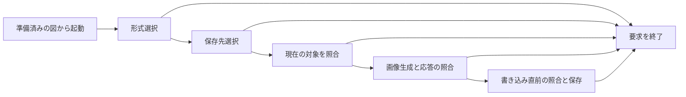

# 設計

## 背景と制約

- 提案: [proposal.md](proposal.md)
- 前提: `openspec/tech.md の アーキテクチャ`、`技術上の判断基準`、`テスト方針`と`openspec/structure.md の 配置原則`、`依存方向`に従う。
- `DiagramControls.tsx`は既存の倍率操作部、`StateDiagram.tsx`は計測済みの配置、接続点、矢尻と表示範囲の確定を担当している。
- `preview-protocol/index.ts`はZodによる通信契約、`preview-panel.ts`は単一パネルと現在の通知の照合を担当する。\
  現在の通信には画像生成と保存の契約がなく、WebviewのCSPには画像読み込みの許可もない。
- GlitchFlowの`render-preview.ts`と`preview-panel.ts`で、`⇩`、形式選択、保存先選択、要求の照合と保存という流れを確認した。\
  その図は単一SVGだが、GlitchStateはHTMLの状態ノードとグループ、別のSVG要素の矢印から成るため、SVG要素を1つ複写するだけでは全体を保存できない。
- 今回の調査で新たな依存を必要とする箇所はない。\
  Core、DSL、React Flowの配置規則とプロダクトの検査コマンドは変更しない。

## 設計判断

### D-01 - GlitchFlowと同じ保存の入口

- 選択: `DiagramControls.tsx`の拡大ボタンと倍率表示の間に、表示文字`⇩`、aria-labelとtitleが`図をエクスポート`のネイティブbuttonを追加する。\
  計測完了前と保存中はそのボタンを無効にし、図がなければ既存の操作部ごと表示しない。\
  ExtensionでPNG、SVGの順のQuick Pickと、選んだ拡張子だけのSave Dialogを開く。\
  初期URIは対象URIの`.gls`を選んだ拡張子へ置き換え、保存ラベルは`図を保存`とする。
- 理由: 既存の倍率とResetを保ちながら、利用者が指定したGlitchFlowの操作順と名前にそろえられる。
- 代替案: PNGとSVGの個別ボタンやWebview独自の保存メニューは、GlitchFlowと入口が異なるため採用しない。
- 昇格: なし。

### D-02 - 表示準備が完了した図の取得

- 選択: `StateDiagram.tsx`から、現在の文書URI、version、sequenceに結び付いた保存可能な図の取得先を`Preview.tsx`とページの公開インターフェースを通じてappへ渡す。\
  現在の図のノードとグループの実測、接続点と配置、表示範囲が確定するまで取得先を有効にしない。\
  `ui/capture-state-diagram.ts`をDOMの境界とし、状態ID、グループID、絶対矩形、名前の実際の行と位置、実際の矢印の経路とマーカー、解決済みの配色を取得する。\
  図の外側のHTMLを渡さず、画面のviewport行列の逆変換で図の座標へ正規化する。\
  別の文書や描画世代の取得先は使わず、画像用の取得処理から配置や状態選択、viewportのストアを更新しない。
- 理由: 解析済みモデルから別のレイアウトを作ると、長い名前の折り返し、実線枠と実際の経路がプレビューとずれるためである。\
  計測値の保持と現在の接続点の確定を含む既存の準備完了処理を使い、初期計測と通知が前後しても未確定の図を渡さない。
- 代替案: 表示を一時的にfitViewして画面を撮影する方法と、ディスクのDSLを読み直して図を作る方法は採用しない。
- 昇格: なし。

### D-03 - 通常の背景を持つ単独のSVG

- 選択: `model/serialize-state-diagram.ts`で、取得した図の情報からSVGのrect、path、text、tspanとmarkerを生成する。\
  HTMLのforeignObjectや図全体の埋め込み画像は使用しない。\
  状態名とグループ名の改行と折り返しは、DOMの文字範囲と実測位置から行ごとに保存し、新しい折り返し規則を設けない。\
  名前はテキストとしてエスケープし、外部スタイル、外部画像、スクリプトとイベント属性を含めない。\
  フォントの指定と解決済みの色、線幅を画像内に明示し、CSS変数とテーマへの外部参照は残さない。\
  選択中のノードにも既存の`--state-node-background`が表す通常の背景を使い、画面の選択状態を解除して色を取得する方法は使わない。
- 理由: 利用者が選んだ背景と選択除外を、SVGとPNGで共通にできる。\
  ネイティブのSVG図形と文字なら、SVGとして拡大でき、PNG変換時のHTML依存も避けられる。
- 代替案: React FlowのHTML全体をforeignObjectへ包む方法と、PNGをSVGへ埋め込む方法は採用しない。
- 昇格: なし。

全体の範囲はノードと枠、名前の矩形、各矢印の曲線、線幅と矢尻の占有領域の和集合から決める。\
SVGのviewBoxと平行移動で原点を正規化し、viewportの幅と高さでは切り取らない。\
自己ループの曲線の張り出し、相互遷移の曲がり、枠からの集約矢印の始点も範囲へ含める。\
マーカーは画像内のIDへ参照をそろえ、実際の経路終端に沿う向きを維持する。\
背景矩形は全体の最背面へ置き、ノードの通常背景と指定カラー、枠と名前、淡い矢印をプレビューと同じ重なり順で描く。\
操作部、倍率、表、図の見出し、エラー案内、React Flowの接続点と補助表示は列挙対象に入れない。

### D-04 - 同じSVGからPNGを生成する

- 選択: `ui/rasterize-state-diagram.ts`で、保存用SVGのBlob URLをImageとして読み込み、Canvasへ描画してPNGにする。\
  正の有限の寸法を検査し、設定した倍率、最大辺と最大画素数のすべてを満たす倍率を求める。\
  PNGは全体の比率と内容を保ったまま生成し、画像生成と符号化の失敗を上位へ返す。\
  Blob URLと一時的なDOMはfinallyで解放する。\
  CSPはこのローカル画像読み込みに必要な`img-src blob:`を追加し、外部の画像や通信は許可しない。
- 理由: SVGとPNGで範囲、通常背景と矢尻の解釈を別々に実装する必要がない。\
  既存のブラウザー機能で足りるため、画像生成ライブラリは追加しない。
- 代替案: 画面サイズに応じたスクリーンショットと、SVGとは別のCanvas描画処理は採用しない。
- 昇格: なし。

### D-05 - 要求の照合と保存のライフサイクル

- 選択: `preview-protocol/index.ts`へ、保存の起動、画像生成要求、成功または失敗の応答、保存処理の終了を区別するメッセージを追加する。\
  各処理を要求IDと文書URI、version、sequence、形式へ結び付け、更新通知と画像生成要求は別の型で受け取る。\
  `app/main.tsx`は準備済みの現在の図だけを生成先へ渡し、古い取得先では生成しない。\
  `src/extension/diagram-export.ts`へ保存フローを置き、`preview-panel.ts`から現在の通知、受理した描画完了とパネルの存続を照合して呼び出す。\
  ダイアログ終了後、生成応答の受信後と書き込み開始の直前に照合し、文書と内容が更新されていれば再操作の案内で終了する。\
  キャンセル、失敗、更新、パネルの破棄のいずれでも要求を解放し、古い要求の応答を次の要求へ流用しない。
- 理由: 同じURIでも版番号が戻ることがあるため、versionの大小ではなく現在の通知との一致と要求IDを使う必要がある。\
  保持した正常モデルも現在の表示として扱い、ディスクの内容と混ぜない。
- 代替案: URIだけの照合、versionの大小による拒否、常に最新のモデルへ保存途中で差し替える方法は採用しない。
- 昇格: なし。

保存中は1件だけを受理し、Webviewの保存ボタンとExtension側の両方で重複を防ぐ。\
倍率、移動と選択の操作は保存対象の内容の更新として扱わず、保存処理がそれらを変更することもない。\
テーマと通常背景は、現在の図から保存用の情報を取得した時点のものを画像内へ固定する。\
ファイル書き込み開始後の文書更新は、開始済みの書き込みの画像へ混入させない。\
保存先はExtensionが保持し、Webviewから任意の保存先を受け取らない。\
Save Dialogで選択した拡張子を検査し、PNGのBase64とシグネチャ、SVGのルートと形式を確認してから`workspace.fs.writeFile`へ渡す。\
Zodで型、識別子と必須フィールドを検証し、不正な現在の応答では失敗を通知し、別要求の応答は無視する。\
形式と保存先の選択、通知と書き込みは外部との境界として引数へまとめ、単体テストで差し替える。\
既存のプレビューの作成元にはVS Code APIを使う既定の境界を接続する。

次の値は要件の約束ではなく暫定の調整値とする。\
同じ値を別の場所とテストへ直接書かず、定義した場所を参照する。

| 値 | 暫定値 | 理由 | 定義する場所 |
| --- | --- | --- | --- |
| 全体の余白 | 16図座標単位 | 文字と線が画像の縁へ接しないようにする | Webviewの`model/diagram-export-config.ts` |
| PNGの目標倍率 | 2 | GlitchFlowと同様に文字を読み取れる解像度を確保する | 同上 |
| PNGの最大辺 | 16384px | ブラウザーのCanvasへの過大な割り当てを避ける | 同上 |
| PNGの最大画素数 | 64000000 | 辺だけでは制限できない面積を抑える | 同上 |
| 生成応答の待機時間 | 60000ms | GlitchFlowと同じ初期値から検証する | Extensionの`diagram-export.ts`の定数 |
| 画像応答の最大バイト数 | 64MiB | 不正な大きさの応答を保存処理へ渡さない | `preview-protocol/export-config.ts` |

### D-06 - 既存テストの変更を操作部の差分へ限定する

- 選択: REQ-030-S03とREQ-038-S01の既存テストでは、3ボタンの完全一致を`-`、`Reset`、`+`、`⇩`の4ボタンと名前の一致へ更新する。\
  REQ-038-S04の倍率操作3件のキーボード検査を維持し、保存操作はREQ-041-S02で確かめる。\
  REQ-038-S08は明暗両方で保存ボタンも文字、背景とフォーカスを読めることを追加する。\
  枠の包含、同名状態の区別、自己ループ、倍率と中心、選択と通知の既存assertは維持する。
- 理由: 保存ボタンの追加という依頼に必要な期待値だけを変更し、以前の不具合の検出力を残せる。
- 代替案: ボタンの件数や並びの検査を削除したり、遷移の待機時間を伸ばして合わせたりする方法は採用しない。
- 昇格: なし。

### D-07 - 出力画像と誤実装を検証する

- 選択: テストを先に作り、未実装での失敗を確認する。\
  ブラウザーでは生成したSVGを独立した文書として開き、実際の名前と図形、範囲、配色、経路と矢尻を検査する。\
  PNGも実際にデコードし、寸法だけでなく背景、状態の色、名前、枠と矢印の描画領域を確認する。\
  SVGからPNGへの接続は、同じ図の特徴点と配置を両形式で照合する。\
  保存フローでは要求とは独立した画像データを用意し、保存先のURIと実際の書き込みバイト列、保存しない分岐と再操作を検査する。
- 理由: 保存メッセージの存在やファイル拡張子、画像の寸法だけでは、内容の欠落や空画像を見逃すためである。
- 代替案: 出力文字列の部分一致だけの検査と、対象の生成関数を使って期待画像を作る方法は採用しない。
- 昇格: なし。

## 検証計画

| シナリオID | 設計判断 | 検証方法 |
| --- | --- | --- |
| REQ-030-S01 | D-06 | 自動テスト |
| REQ-030-S02 | D-06 | 自動テスト |
| REQ-030-S03 | D-01、D-06 | 自動テスト |
| REQ-030-S04 | D-06 | 自動テスト |
| REQ-038-S01 | D-01、D-06 | 自動テスト |
| REQ-038-S02 | D-06 | 自動テスト |
| REQ-038-S03 | D-06 | 自動テスト |
| REQ-038-S04 | D-01、D-06 | 自動テスト |
| REQ-038-S05 | D-06 | 自動テスト |
| REQ-038-S06 | D-01、D-06 | 自動テスト |
| REQ-038-S07 | D-02、D-06 | 自動テスト |
| REQ-038-S08 | D-01、D-06 | 自動テスト |
| REQ-041-S01 | D-01、D-05、D-07 | 自動テスト |
| REQ-041-S02 | D-01、D-07 | 自動テスト |
| REQ-041-S03 | D-01、D-02 | 自動テスト |
| REQ-041-S04 | D-01、D-05 | 自動テスト |
| REQ-041-S05 | D-05、D-07 | 自動テスト |
| REQ-042-S01 | D-02、D-03、D-04、D-07 | 自動テスト |
| REQ-042-S02 | D-02、D-03、D-07 | 自動テスト |
| REQ-042-S03 | D-03、D-04、D-07 | 自動テスト |
| REQ-042-S04 | D-03、D-07 | 自動テスト |
| REQ-042-S05 | D-04、D-07 | 自動テスト |
| REQ-042-S06 | D-02、D-03、D-07 | 自動テスト |
| REQ-042-S07 | D-02、D-03、D-07 | 自動テスト |
| REQ-043-S01 | D-02、D-05、D-07 | 自動テスト |
| REQ-043-S02 | D-02、D-05 | 自動テスト |
| REQ-043-S03 | D-05、D-07 | 自動テスト |
| REQ-043-S04 | D-04、D-05 | 自動テスト |
| REQ-043-S05 | D-05 | 自動テスト |
| REQ-043-S06 | D-02、D-05、D-06 | 自動テスト |

REQ-041-S01とREQ-041-S04〜REQ-041-S05、REQ-043-S02〜REQ-043-S05の主な検証層は、Extensionの保存フローと通信境界の単体テストとする。\
URI、形式、要求と応答の照合、ダイアログの引数、書き込みのバイト列と回数を確かめる。\
REQ-041-S02〜REQ-041-S03、REQ-042の全シナリオ、REQ-043-S01とREQ-043-S06はブラウザーで確かめる。\
特にREQ-043-S01は以前と異なる修正後の名前と終点、REQ-043-S06は取得前後の3表示、選択、実際のviewportと通知を比較する。\
実際のDSLの未保存状態とProblemsの不変性は、Extensionからの更新と保存フローを結ぶ接続確認で補う。\
MODIFIEDの全シナリオは既存のブラウザーテストを使い、変更した操作部のassert以外を保持する。\
SVGのエスケープ、範囲の和集合、PNG倍率の計算と型検証は部品の単体テストとし、ブラウザーはそれらの接続と実画像を検証する。\
画像生成はブラウザーだけの緩いCSPでは済ませず、Extensionが作るCSPの画像許可との接続を確認する。\
保存ボタンからExtensionへの起動と生成要求への応答も接続確認とし、同じ保存分岐の組み合わせを各層へ重複して並べない。

誤実装の確認は、表示範囲だけの切り取り、選択強調の混入、暗テーマでも白背景、自己ループの張り出しの欠落、矢尻の180度固定、名前の末尾の欠落、空PNG、修正後も古い図、別文書の応答の採用を対応するテストで検出する。\
PNGの各境界は調整値を参照し、最大辺が制約になる例と最大画素数が制約になる例を独立に置く。\
状態0件、計測中、キャンセル、不正応答と送信失敗が異常と境界の観点を担う。\
新しい実機確認と非機能要件は設けず、既存のREQ-004-S04とREQ-016-S02の記録は変更しない。

## リスクと移行

- DOMの実測、テキストの行、SVG経路の座標系が異なる。\
  同じ準備済みの図から取得し、ノードと曲線、矢尻の全体範囲、名前の末尾を別々に検査してずれと切れを検出する。
- PNG変換はCanvasの制約を受ける。\
  設定した倍率と面積の範囲へ収め、変換不能時にはファイルを書かずに理由を通知し、一時資源を解放する。
- 保存処理中にも文書の編集と切替が起こる。\
  書き込み開始まで対象を照合し、古い結果は採用せず、再操作で現在の画像を保存する。
- Webviewのメッセージ分岐を増やすことで、既存の更新と描画完了が混ざるおそれがある。\
  型を分離し、更新、再オープン、計測競合、選択と表示範囲の既存回帰テストを全体検証で維持する。
- DSLと既存ファイルの移行はない。\
  失敗時はこの保存機能の変更を戻せば従来の3ボタンへ戻せる。
