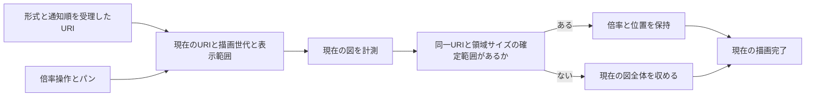

# 設計

## 背景と制約

- 提案: [proposal.md](proposal.md)
- 差分仕様: [state-transition-diagram](specs/state-transition-diagram/spec.md)
- 前提: `openspec/tech.md`のアーキテクチャ、技術上の判断基準、テスト方針と、`openspec/structure.md`の配置原則、依存方向に従う。
- 確認: ローカルのGlitchFlowの`src/webview/pages/preview/ui/render-preview.ts`は、左から`-`、`Reset`、`+`、倍率表示を持ち、読み上げ用の名前は縮小、等倍、拡大である。\
  同プロジェクトの`model/zoom.ts`ではResetが1、ボタンの加減が0.1、範囲が0.5から2である。\
  エクスポートは今回の対象外で、GlitchFlowのスクロール式の図をそのまま移植せず、操作の順序と意味を合わせる。
- 確認: 現在の`StateDiagram.tsx`はgraph identityでReactFlowProviderを再生成し、ノードとグループの計測、領域の寸法とlayoutKeyに応じて全体を収め直す。\
  状態名や色、所属と矢印の変更でもidentityが変わり、表示範囲は図のインスタンス内にしかない。\
  `Preview.tsx`からは対象URIを図へ渡しておらず、同じ図を持つ別文書を区別できない。
- 確認: `app/main.tsx`は形式とsequenceを拒否してから選択を整合し、`render-completion.ts`は現在のURIとsequenceの描画完了だけを送る。\
  `state-groups.spec.ts`のREQ-030-S03は図内のボタン0件を検査しているため、今回の変更に伴う限定的な更新が必要である。
- 確定: Resetは表示中心を保って100%へ戻し、同一文書のDSL編集は配置変更を含め倍率と位置を保つ。\
  初回と文書切替、表示領域のサイズ変更時は全体表示とし、Core、Extension、通知契約と選択の規則は変更しない。

## 設計判断

### D-01 - 図の上部へ3操作と倍率表示を置く

- 選択: `pages/preview/ui/DiagramControls.tsx`に、左から縮小、Reset、拡大のネイティブbuttonと、読み上げ用の名前を持つ%表示を置く。\
  操作部は図領域の見出しの下、キャンバスの上とし、React Flowのパン領域の外へ置く。\
  状態0件と正常モデルなしでは表示せず、キャンバスと計測の準備前はボタンをdisabledにする。\
  React Flowの現在のzoomを購読して、ボタンだけでなくホイールと初期表示の倍率を%へ反映する。\
  表示の丸めは表示用だけとし、実際のzoomを丸めた%から逆算しない。
- 選択: `diagram.css`の操作部の定義1か所へ、余白8px、ボタンの縦余白4pxと横余白9px、フォーカスの太さ1pxと間隔2pxを仮定義する。\
  GlitchFlowの間隔を参考にし、色はVS Codeのbuttonとforeground、editor、focusBorderの変数を使って明暗テーマへ追従させる。\
  既存の図の高さと状態選択の背景、グループ枠の線は変更しない。
- 理由: GlitchFlowの表示順と意味を保ち、操作部を押した際に図をドラッグせず、追加操作で既存の表を縮小しないためである。
- 代替案: React Flowの既定Controls、キャンバス上に重なるボタン、画像保存を含む操作部は採用しない。
- 昇格: なし。

### D-02 - 現在の中心を基準に倍率を変更する

- 選択: `pages/preview/model/diagram-viewport.ts`に、倍率の制限と表示中心を保つ計算を置く。\
  キャンバスの幅W、高さH、現在の表示範囲x、y、zoomから、中心の図座標を`((W/2-x)/zoom, (H/2-y)/zoom)`として求める。\
  新しい倍率zでは`x'=W/2-centerX*z`、`y'=H/2-centerY*z`とし、React FlowのsetViewportへ一度に適用する。\
  Resetの倍率は意味上の定数1とし、現在の中心を保つ同じ経路へ通す。\
  すでに1の場合は位置を変更しない。
- 選択: `model/diagram-config.ts`を倍率の調整値の定義元とし、既存のminZoom=0.01を保持、maxZoomを2へ変更、ボタンの加減zoomStepを0.1として追加する。\
  上限と刻みはGlitchFlowを参考にし、下限は既存の大きな図の全体表示を維持するためGlitchFlowの0.5へ変更しない。\
  初回の全体表示の拡大上限は従来の1をinitialMaxZoomとして区別し、全体が小さい図を初回から過度に拡大しない。\
  いずれも調整値として1か所へ定義し、テストもその値を参照する。\
  操作は即時に反映し、独自のアニメーションと完了通知は追加しない。
- 理由: 倍率だけの変更で見ている箇所が原点や図の中央へ移動せず、全体表示と等倍を区別できるためである。
- 代替案: 原点固定のscale、ResetからfitViewを呼ぶ処理、毎回の初回範囲への復帰、ボタンとホイールの異なる上下限は採用しない。
- 昇格: なし。

### D-03 - 現在の文書の表示範囲を図の再生成から分離する

- 選択: `diagram-viewport.ts`へZustandのvanillaストアと独立した生成関数を置く。\
  保持するのは現在のURI、現在の受理通知に対応する描画世代、最後に確定したx、y、zoomと、そのときの表示領域の幅と高さだけとし、モデルを複製せず文書別Mapと永続保存を持たない。\
  同じURIの新しい通知では描画世代だけを更新し、状態0件とエラーを含め既存の表示範囲を保持する。\
  URIが変わったときだけ表示範囲を未確定へ戻し、元の文書へ戻っても過去の表示範囲を復元しない。
- 選択: `pages/preview/index.ts`から公開し、`app/main.tsx`の既存の形式とsequenceの拒否の後で受理通知を適用する。\
  `Preview.tsx`を通してdocumentUriと受理通知に対応する描画世代を図へ渡す。\
  図と操作のコールバックは現在のURIと描画世代を照合してから記録し、古い図の遅れた計測と移動のコールバックで現在の記録を戻さない。\
  React Flowへの依存はUI側の境界に置き、ストアは単純なx、y、zoomを扱う。
- 選択: 準備済みの図ではボタンとReset、ホイールとドラッグの現在値を記録する。\
  同一URIの再オープンとコマンド再実行でもversionを判断に使わない。\
  Webviewを作り直したらストアを新しくし、表示範囲は未確定から始める。
- 理由: graph identityと状態数によって現在の閲覧位置を失わず、同じ図を持つ異なる文書の範囲を混入させないためである。
- 代替案: ReactFlowProviderの内部だけの記憶、図のidentityを文書識別に使う処理、URI別履歴、選択ストアへの混在は採用しない。
- 昇格: なし。

### D-04 - 現在の図の計測と表示範囲の確定を分ける

- 選択: `StateDiagram.tsx`の既存のノードとグループの計測、layoutStateGroupsとconnectDiagramEdgesを維持する。\
  図の再生成が必要な場合も、同一文書の確定した範囲を初期viewportとして引き渡し、表示領域のサイズが同じなら再計測後も同じ範囲を適用する。\
  初回と文書切替で範囲が未確定の場合、または記録した表示領域の幅と高さが現在と異なる場合に、既存のグループの絶対座標と自己ループの余白を含む全体表示を計算する。\
  全体表示の上限はD-02のinitialMaxZoomを使う。
- 選択: graph identity、layoutKeyとviewKeyへ操作後のviewportと選択IDを混ぜない。\
  表示範囲の保持は配置の凍結ではなく、モデル由来のノードと枠、矢印を現在の内容へ更新したうえで、x、y、zoomだけを保つこととする。\
  ノードと枠の計測値の変更だけでは再fitせず、表示領域の幅と高さの実際の変更時は、従来どおり現在の図全体を収め直す。\
  適用後の範囲と幅と高さを同時に記録し、その後のDSL編集では新しい表示範囲を保持する。
- 選択: 最新の受理内容の計測と範囲適用後のフレームを確認してからonRenderReadyを呼び、既存のURIとsequenceの描画完了の照合を維持する。\
  古いrequestAnimationFrameと非同期のviewport適用は後始末し、D-03の世代とURIの検査でも拒否する。\
  選択と表示操作で新しい描画世代を作らず、操作だけで準備完了を再通知しない。
- 理由: 以前の範囲を保つために内容まで古くしたり、保持した場合だけ完了通知を失ったりしないためである。
- 代替案: 常時のfitView、モデルの更新を省く処理、選択やズームのたびにProviderを作り直す処理、計測より先の完了通知は採用しない。
- 昇格: なし。

### D-05 - 既存の選択とグループ、両表を維持する

- 選択: REQ-030-S03の既存テストのボタン0件のassertだけを、REQ-038の3操作の表示と名前の完全一致へ更新する。\
  初回の長い名前と枠、ノードと自己ループの包含、実際の矢尻、図のクリックによる選択禁止のassertは維持する。\
  それ以外のREQ-030の既存シナリオIDと名前、期待値を変えない。
- 選択: 表示範囲の操作を状態選択と切り離し、選択行と該当ノード、該当状態列の背景だけの強調を維持する。\
  ボタンによる拡大縮小とReset、パンとホイールはモデルとDSL、診断、表のサイズを変更しない。\
  既存の状態名と指定カラー、淡い矢印と実際の矢尻の向き、集約と自己ループも維持する。
- 理由: 操作部の追加だけを理由に既存の配置と選択、グループの検査まで緩めないためである。
- 代替案: ボタン検査全体の削除、図の選択の有効化、両方の表を含むプレビュー全体へのscaleは採用しない。
- 昇格: なし。

### D-06 - 実際の変換と異なる更新内容で検証する

- 選択: 表示範囲の計算とURI、世代の保持の部品を単体で先に確かめる。\
  図の中心とResetの期待座標は入力から手計算し、対象関数で期待値を作らない。\
  調整値だけD-02の定義を参照し、判断が同じ組み合わせを増やさない。
- 選択: ブラウザーで実際のviewportの変換とキャンバス寸法を読み、中心の図座標と倍率、%表示、全ノードと実経路を照合する。\
  ウィンドウのサイズ変更後に全体を収める既存のREQ-014-S01を維持し、その後のDSL編集で新しい範囲が保持されることも確かめる。\
  初回とは異なるパンと倍率、大きな図、通常矢印と自己ループ、グループ集約を用い、ラベルだけ変える偽の倍率操作を検出する。\
  更新系列は状態数と名前、所属と順序、処理と条件と遷移先、分類と見出しを以前と異ならせ、3表示の現在の内容と実際の矢印を確認する。
- 選択: 正常表示、参照エラーで保持、エラー中の追加操作、修正の流れでは、最後の操作後の表示範囲と現在の内容、案内の消去を照合する。\
  小さいversionとコマンド再実行、別URIへの切替、状態0件と再追加、新Webview、遅れた通知と計測を個別の境界として確認する。\
  Problemsの診断消去と実際のcloseとopenは、既存のExtension単体と実VS Code統合で回帰し、ブラウザーで確認した選択と表示範囲の境界を区別する。
- 選択: 一時コピーで、%だけ変更、中心を原点固定、Resetを全体表示に変更、更新で毎回fit、モデルを古いまま固定、図identityだけでURIを判定、状態0件で範囲を消去、version低下で初期化、拒否する通知より前に範囲を変更、古い計測で範囲を上書き、操作だけで完了通知を送信、表示領域のサイズ変更を無視する誤実装をそれぞれ適用する。\
  対応するassertの失敗と復元後の成功を確認し、起動と型検査の失敗を代用しない。
- 選択: READMEと仕様一覧を更新し、既存の依存と検査コマンドを使う。\
  プロダクトの実装と検査設定はffでは変更しない。
- 理由: 倍率表示の文字だけや同じ正常モデルだけを比較すると、実際のズームと保持、現在の更新の欠落を見逃すためである。
- 代替案: 対象関数から作る期待値、通知数だけの検査、以前と同じ内容への修正、全パラメーターの直積は採用しない。
- 昇格: なし。

## 検証計画

| シナリオID | 設計判断 | 検証方法 |
| --- | --- | --- |
| REQ-038-S01 | D-01、D-05 | 自動テスト |
| REQ-038-S02 | D-01、D-02、D-05 | 自動テスト |
| REQ-038-S03 | D-02 | 自動テスト |
| REQ-038-S04 | D-01 | 自動テスト |
| REQ-038-S05 | D-01、D-03 | 自動テスト |
| REQ-038-S06 | D-01、D-03 | 自動テスト |
| REQ-038-S07 | D-01、D-04 | 自動テスト |
| REQ-038-S08 | D-01、D-05 | 自動テスト |
| REQ-039-S01 | D-02 | 自動テスト |
| REQ-039-S02 | D-02 | 自動テスト |
| REQ-040-S01 | D-03、D-04 | 自動テスト |
| REQ-040-S02 | D-03、D-04、D-05 | 自動テスト |
| REQ-040-S03 | D-03、D-04、D-06 | 自動テスト |
| REQ-040-S04 | D-03 | 自動テスト |
| REQ-040-S05 | D-03、D-04 | 自動テスト |
| REQ-040-S06 | D-03、D-04 | 自動テスト |
| REQ-040-S07 | D-03、D-04、D-06 | 自動テスト |
| REQ-040-S08 | D-03、D-04 | 自動テスト |
| REQ-040-S09 | D-03、D-04、D-05 | 自動テスト |
| REQ-040-S10 | D-03、D-04、D-06 | 自動テスト |
| REQ-030-S01 | D-04、D-05 | 自動テスト |
| REQ-030-S02 | D-04、D-05 | 自動テスト |
| REQ-030-S03 | D-01、D-04、D-05 | 自動テスト |
| REQ-030-S04 | D-04、D-05 | 自動テスト |

倍率制限と中心の計算、URIと世代による保持と破棄は部品の単体を基本とする。\
その同一シナリオのブラウザー検査は、実際の操作と変換、受理通知とモデル更新、計測と描画完了へのつながりの確認に限る。\
UIの表示とキーボード、テーマ変数、図の実際の倍率と中心、表示範囲の保持、現モデルと両表の整合はブラウザーを主な観測層とする。\
REQ-030は既存の実線枠と配置、同名状態の包含、除去後の配置のテストを維持する。\
新しいDSL、Core解析とExtensionの分岐はなく、構文の異常の追加検査は対象外である。\
新しい性能の約束と実機確認項目は追加せず、既存のREQ-004-S04とREQ-016-S02の実機確認を確認済みへ変更しない。\
非機能の追加測定手順はない。

## リスクと移行

- 既存のmaxZoom=1のままでは等倍から拡大できない。\
  操作用の上限と初回の全体表示の上限を分離し、小さい図の初回倍率と大きい図の包含を維持する。
- 図のidentityの変更と倍率の変更を混同すると、編集で操作後の範囲を失う。\
  範囲を図のインスタンスから分け、配置更新を止めずに表示範囲だけを維持する。
- 別文書が同じモデルの場合、identityだけでは文書切替を検出できない。\
  受理したURIで範囲を破棄し、古いコールバックも描画世代で拒否する。
- 新たな状態や変更後の枠が画面外になる場合がある。\
  利用者が選んだ表示範囲保持を優先し、ドラッグと縮小で確認できるようにする。\
  Resetを全体表示へ変更しない。
- 移行するデータはない。\
  失敗時は操作部と範囲管理の接続を戻して従来の図へ戻せる。\
  正式仕様の同期は実装、verifyの後のarchiveで行う。
