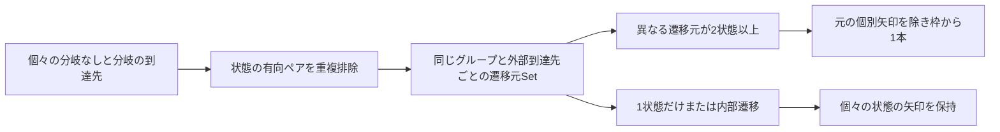

# 設計

## 背景と制約

- 提案: [proposal.md](proposal.md)
- 差分仕様: [state-definitions](specs/state-definitions/spec.md)、[state-transition-diagram](specs/state-transition-diagram/spec.md)、[state-transition-table](specs/state-transition-table/spec.md)
- 前提: `openspec/tech.md`のアーキテクチャ、技術上の判断基準、テスト方針と、`openspec/structure.md`のディレクトリ構成、依存方向に従う。
- 現状: Coreのモデルは状態とイベント、両形式の遷移、任意の分類列見出しを持つ。\
  `parse-gls.ts`はState、Event、TransitionとEventCategoryHeadersだけを識別し、通信境界は厳密なZodオブジェクトである。\
  新しいトップレベル宣言を追加するため、REQ-002の許可する範囲も変更する。
- 現状: `build-state-diagram.ts`は全分岐を列挙して状態の有向ペアを重複排除し、`layout-state-nodes.ts`が状態を定義順の行へ並べる。\
  `StateDiagram.tsx`内のconnectEdgesはノードの位置を絶対座標として向きを決め、状態ノードの寸法とviewportの確定後に描画完了を送る。\
  親の相対座標を導入するだけでは、接続の向きと表示範囲、準備完了の条件が不足する。
- 確認: インストール済みReact Flowの型にはparentId、extentと内部ノードのpositionAbsoluteがあり、既存の依存でコンテナと子状態を表せる。\
  新しいライブラリは追加しない。
- 確定: 平坦で重複所属のない2状態以上のグループ、異なる2メンバー以上から同じ外部状態への集約を利用者が承認した。\
  全メンバーの一致、到達先グループへの集約、内部遷移の集約、選択連動は対象外である。

## 設計判断

### D-01 - 状態の参照だけを持つStateGroupを宣言する

- 選択: `StateGroup <ID> as "<名前>":`の下へ、半角空白4個で下げた状態IDを1行1件で並べる。\
  グループIDと状態IDの形式、名前の非空白と引用符は既存の状態に合わせ、キーワード間の半角空白1個以上と行末空白を許可する。\
  2件以上の異なる宣言済み状態を必要とし、グループIDは専用の名前空間、所属状態の参照先は状態だけとする。\
  同じ名前を持つ別IDは有効で、同じ状態の複数所属と入れ子は拒否する。
- 選択: グループ宣言と所属IDの配列はDSLの宣言順で保持する。\
  図内の状態の順は状態そのものの定義順を使い、所属IDの記述順で両表や状態の順を変えない。\
  グループIDをTransitionやBranchの状態参照に使う構文は設けず、同じIDの実状態も宣言済みならその状態を参照する。
- 理由: 既存の状態定義や遷移をネストへ移す必要がなく、グループの編集が個々の設計情報を変更しない。
- 代替案: 状態をグループ内へ再定義する案、複数所属、1状態のグループ、暗黙の遷移継承は採用しない。
- 昇格: なし。

```gls
StateGroup ACTIVE as "稼働系":
    IDLE
    RUNNING
```

### D-02 - Coreに所属情報と元の行を追加する

- 選択: `core/model/gls-model.ts`へ`StateGroupDefinition { id, name, stateIds }`と`GlsModel.stateGroups?: readonly StateGroupDefinition[]`を追加し、公開型を`core/index.ts`から公開する。\
  グループ宣言が0件ならstateGroupsを省略し、既存モデルへ空配列を補わない。\
  既存のstates、events、transitionsとeventCategoryHeadersの構造と内容を変更しない。
- 選択: `parse-gls.ts`へグループのBlockを追加し、宣言と各所属行の元の行番号を候補に保持する。\
  所属行は既存の4空白の本文収集を利用し、末尾の半角空白を除いた1つのIDとして読む。\
  StateGroupの不正な宣言はsyntaxとし、独立した旧不正例`Group STATES`はunsupportedのままにする。\
  状態と処理の通常の本文にあるStateGroupという文字列を、グループ宣言へ読み替えない。
- 選択: 新しい`core/validator/validate-state-groups.ts`で全宣言後に、名前とID、2状態以上、状態の存在、専用IDの重複と所属の重複を検証する。\
  グループの参照を既存の遷移検証へ渡さず、元の所属行、後の所属行、宣言行というREQ-029の診断位置を保ち、文書全体の誤りではmodelをnullにする。
- 理由: 参照の前後関係を問わず、構文と所属の検証を図から独立させ、既存DSLの完全一致を回帰確認できる。
- 代替案: 図で所属IDを解釈する案、エラーのあるメンバーを落として受理する案は採用しない。
- 昇格: なし。

### D-03 - 通知境界でグループ全体を検証する

- 選択: `preview-protocol/index.ts`へ任意のstateGroups配列を追加する。\
  各要素はid、name、stateIdsだけの厳密オブジェクトで、ID形式、名前の非空白と引用符と改行、2件以上で重複のない状態IDを検証する。\
  文書全体の検証で専用IDの一意性、すべての所属先の存在、全グループ間の重複所属を確認する。\
  項目の省略と空の一覧はグループなしとして受理し、一覧や要素のnull、型違い、余分なネスト、不足する必須値は拒否する。
- 選択: 状態と同じグループIDを許可し、遷移は既存と同じ状態集合だけで検証する。\
  グループが不正なら通知全体を拒否し、stateGroupsだけを捨ててほかの表示を進めない。\
  既存の分類と両形式の遷移、URIと版番号とsequenceの検証を保つ。
- 理由: 不正な所属で図を破損させず、正常表示を保持する既存の通知契約を拡張できる。
- 代替案: 任意の追加項目の受理と、Webviewでの補正やDSLの再解析は採用しない。
- 昇格: なし。

### D-04 - 個々の有向ペアを作ってから集約する

- 選択: `build-state-diagram.ts`は先に既存と同じ全遷移先の状態有向ペアを作り、nullを除外して重複排除する。\
  所属Mapを作り、到達先が同じグループのメンバーではないペアだけを、グループIDと到達先状態IDの組へ分類する。\
  各組の異なる遷移元状態IDをSetで数え、2件以上なら元のペアを表示Edgeから除き、枠から対象状態へのEdgeを1件だけ出す。\
  全メンバーの一致は要求せず、イベントと分岐の件数で水増しせず、ほかの到達先と別グループを混同しない。
- 選択: 個別Edgeは従来のsourceとtargetを使い、図用グループノードのIDは`state-group:<グループID>`として状態IDと衝突させない。\
  集約Edgeのsourceだけをその図用IDへ変え、targetは常に実状態IDにする。\
  グループノードと状態ノードはWebviewの型で区別し、CoreにReact Flowの型を持ち込まない。\
  グループなしの出力と個別EdgeのIDを維持し、入力モデルの配列と遷移を変更しない。
- 理由: 同じ1状態の重複遷移を複数メンバーと誤認せず、全分岐を対象にした集約と個々の意味の保持を両立できる。
- 代替案: Coreの遷移をグループへ書き換える案、全メンバーの遷移を要求する案、到達先をグループ枠へ変える案は採用しない。
- 昇格: なし。



### D-05 - 親枠と子状態を実測して配置する

- 選択: 図用のグループノードを所属状態より先に登録し、状態へparentIdとextentを設定する。\
  新しい`ui/StateGroup.tsx`は名前、透明な内部と実線の枠、不可視の出力ハンドルだけを持つ。\
  個別の状態の名前とカラー、各方向とループのハンドルは`StateNode.tsx`を利用し、選択と接続編集は既存と同様に無効のままにする。
- 選択: グループがある場合だけ新しい`model/layout-state-groups.ts`を使い、グループ内は状態定義順、既存のcolumnsと幅と行の最大実測高で並べる。\
  上位の領域は各グループの最初の状態と未所属状態の定義順で並べ、グループは独立した行、間の連続する未所属状態は既存の折り返し行へ置く。\
  名前の折り返し実測高を枠の上部へ確保し、各内部行の上へ既存loopExtentの2倍の空間を確保してループ全体を枠内へ収める。\
  枠の実寸を確定して次の領域へ進めるため、非連続の所属を含めても別状態や枠が入り込まない。\
  グループなしは既存のlayoutStateNodesへ戻し、両表の配列は並べ替えない。
- 選択: `StateGroup.tsx`の名前要素だけをResizeObserverで実測し、DiagramCanvasの表示用の寸法Mapへ通知する。\
  枠全体の高さを名前の高さへ戻す循環を作らず、幅が決まった名前と状態の計測から枠の幅と高さを計算する。\
  グループと状態の描画順とz-indexを明示し、枠の背景で状態や矢印を隠さない。
- 調整値: `diagram-config.ts`のDIAGRAM_CONFIGへgroupPaddingを24、groupLabelMinHeightを24、groupLabelGapを16として1か所に置く。\
  グループ名と状態、枠の接触を避けるための初期値であり、columns、nodeWidth、columnGap、rowGapとloopExtentは既存値を使う。\
  `diagram.css`に`--diagram-group-line-width: 1px`を1回定義し、色は既存のdiagram-foreground、内部は透明、名前はpre-wrapとoverflow-wrapで表示する。\
  名前が長ければ実測で高さを増やし、余白と線幅のテストは定義値を参照する。
- 理由: 既存状態の外接矩形を囲むだけでは未所属状態も入り込み、長い名前やループの高さを欠落させるためである。
- 代替案: 全状態の従来座標の外側へ枠を重ねる案、固定高の名前、親の寸法だけで配置完了とする案は採用しない。
- 昇格: なし。

### D-06 - 絶対矩形と現在の配置を矢印と完了に使う

- 選択: `StateDiagram.tsx`の接続点選択を、新しい`model/connect-diagram-edges.ts`へ移し、グループの枠と状態の絶対矩形を使って出入りの方向を選ぶ。\
  子状態の相対位置だけでグループ外の到達先との方向を比較しない。\
  グループなしの接続選択は維持し、集約Edgeは枠のハンドルから実状態のハンドルへ接続する。\
  `StateEdge.tsx`の淡い線と実形状の矢尻を利用し、個別の相互遷移と自己ループを保つ。\
  集約の往路と個別の復路も完全に重ならない経路として確認する。
- 選択: 図のidentityにグループIDと名前、所属、親子関係と表示Edgeを含める。\
  状態だけでなく現在のグループ名の実測と枠、内部と外部の矢印、viewportの確定まで準備完了としない。\
  表示範囲は親子の絶対矩形とループの余白から求め、子の相対座標をそのままgetNodesBoundsへ渡さない。\
  既存のURIとsequenceによる描画完了照合とキャンセルを利用し、古い計測とviewport確定で現在の通知を完了させない。
- 理由: 名前だけや所属だけの編集も図の変更であり、親ノードを追加しても正しい境界の矢印と最初の表示完了を保証する必要がある。
- 代替案: グループ情報をidentityから除く案、枠の完成前に表だけで完了する案、文書versionだけで通知順を判定する案は採用しない。
- 昇格: なし。

### D-07 - 共通モデルの個別定義と既存の文書管理を保つ

- 選択: `Preview.tsx`と`TransitionTable.tsx`は既存のstates、events、transitionsから両表を表示し、stateGroupsによって行と列、IDの交点と分岐セルを変えない。\
  `build-state-diagram.ts`だけが描画用の集約を行い、両表のためにグループモデルを展開する処理は設けない。
- 選択: ExtensionのURIごとのlastGood、文書のcloseの後始末、診断、revisionとsequenceを利用する。\
  グループの参照エラーでは同じモデル全体を保ち、修正後は現在のモデル全体へ置き換える。\
  既存の文書管理の実装修正は、新しい回帰テストで不足が判明した箇所に限る。
- 理由: 枠を設計情報の別の情報源にせず、個々の処理と到達先、条件分岐と分類の意味を維持できる。
- 代替案: 表もグループ単位へ統合する案、グループ専用のキャッシュや通知経路は採用しない。
- 昇格: なし。

### D-08 - 枠の包含と本当の矢印の始点を検証する

- 選択: Coreと境界、図変換と配置は手書きのモデルと有向ペア、矩形の期待値でテストを先に追加する。\
  重複遷移と異なる状態の区別、1件と2件、3メンバーの部分一致、内部と外部、別グループと未所属、先頭以外の分岐を独立した例で確認する。\
  既存経路で最初から成功する例は理由を記録し、既存の期待値を実装に合わせて緩めない。
- 選択: ブラウザでは実線のcomputed styleと枠の実座標、所属状態の全領域と名前と自己ループの包含、未所属状態と別枠との非交差、全状態の名前とカラーを確認する。\
  集約矢印の本数だけで済ませず、実経路の始点が枠の境界にありメンバーの境界ではないこと、終点が状態の境界にあること、非零長と既存の方法による矢尻と終端進行方向の一致を確かめる。\
  両表の比較では、グループ付きとなしの表示をIDごとの独立した全セルの期待値へ照合する。
- 選択: 正常、所属参照エラーで保持、異なる全内容への修正をExtension単体とブラウザ、実VS Codeで確認する。\
  単体と統合では所属行の診断と消去、dirtyとディスクの未変更を確認し、ブラウザでは実際の枠と全経路、両表と案内の消去を確認する。\
  自動更新とコマンド再実行の再オープンは別々に閉じる前より小さい版番号をassertする。\
  計測中の編集はグループ名と状態の計測を実際に止め、完了通知時点の実座標と内容を記録する。
- 選択: 一時コピーで、StateGroupを未対応として拒否、所属の重複許可、グループ情報の境界検証の迂回、遷移件数による集約、全メンバー一致の要求、内部遷移の集約、2番目以降の分岐の省略、個別矢印の残存、到達先枠への集約、両表のグループ化、固定の枠高、子の相対座標を実経路の終点へ使う変更、名前または所属だけの編集を図へ反映しない変更、矢尻の180度固定、古い正常モデルの固定、古い完了の受理を単独で適用する。\
  対応シナリオのassertで失敗することと復元後の成功を記録し、起動や型検査の失敗による代用はしない。\
  境界の不正モデルは検査対象以外の項目と参照を有効に保つ。
- 理由: 文字列とEdgeのIDだけでは、枠の包含、始点の誤り、逆向きの集約、古い正常表示の固定を見逃す。
- 代替案: スナップショットだけの検査、件数だけの矢印検査、通知モデルだけで実描画を代用する案は採用しない。
- 昇格: なし。

## 検証計画

| シナリオID | 設計判断 | 検証方法 |
| --- | --- | --- |
| REQ-028-S01 | D-01、D-02、D-03、D-08 | 自動テスト |
| REQ-028-S02 | D-01、D-02、D-03、D-08 | 自動テスト |
| REQ-028-S03 | D-01、D-02、D-03、D-08 | 自動テスト |
| REQ-028-S04 | D-01、D-02、D-03、D-08 | 自動テスト |
| REQ-029-S01 | D-01、D-02、D-03、D-08 | 自動テスト |
| REQ-029-S02 | D-01、D-02、D-03、D-08 | 自動テスト |
| REQ-029-S03 | D-01、D-02、D-03、D-08 | 自動テスト |
| REQ-029-S04 | D-01、D-02、D-03、D-08 | 自動テスト |
| REQ-002-S01 | D-01、D-02、D-08 | 自動テスト |
| REQ-002-S02 | D-01、D-02、D-08 | 自動テスト |
| REQ-002-S03 | D-01、D-02、D-08 | 自動テスト |
| REQ-030-S01 | D-04、D-05、D-06、D-08 | 自動テスト |
| REQ-030-S02 | D-04、D-05、D-06、D-08 | 自動テスト |
| REQ-030-S03 | D-04、D-05、D-06、D-08 | 自動テスト |
| REQ-030-S04 | D-04、D-05、D-06、D-08 | 自動テスト |
| REQ-031-S01 | D-04、D-05、D-06、D-08 | 自動テスト |
| REQ-031-S02 | D-04、D-05、D-06、D-08 | 自動テスト |
| REQ-031-S03 | D-04、D-05、D-06、D-08 | 自動テスト |
| REQ-031-S04 | D-04、D-05、D-06、D-08 | 自動テスト |
| REQ-031-S05 | D-04、D-05、D-06、D-08 | 自動テスト |
| REQ-031-S06 | D-04、D-05、D-06、D-08 | 自動テスト |
| REQ-033-S01 | D-02、D-03、D-04、D-05、D-06、D-07、D-08 | 自動テスト |
| REQ-033-S02 | D-02、D-03、D-04、D-05、D-06、D-07、D-08 | 自動テスト |
| REQ-033-S03 | D-02、D-03、D-04、D-05、D-06、D-07、D-08 | 自動テスト |
| REQ-033-S04 | D-02、D-03、D-04、D-05、D-06、D-07、D-08 | 自動テスト |
| REQ-033-S05 | D-02、D-03、D-04、D-05、D-06、D-07、D-08 | 自動テスト |
| REQ-033-S06 | D-02、D-03、D-04、D-05、D-06、D-07、D-08 | 自動テスト |
| REQ-014-S01 | D-04、D-05、D-08 | 自動テスト |
| REQ-014-S02 | D-04、D-05、D-08 | 自動テスト |
| REQ-014-S03 | D-04、D-05、D-08 | 自動テスト |
| REQ-014-S04 | D-04、D-05、D-08 | 自動テスト |
| REQ-014-S05 | D-04、D-05、D-08 | 自動テスト |
| REQ-015-S01 | D-04、D-06、D-08 | 自動テスト |
| REQ-015-S02 | D-04、D-06、D-08 | 自動テスト |
| REQ-015-S03 | D-04、D-06、D-08 | 自動テスト |
| REQ-015-S04 | D-04、D-06、D-08 | 自動テスト |
| REQ-015-S05 | D-04、D-06、D-08 | 自動テスト |
| REQ-026-S01 | D-04、D-06、D-08 | 自動テスト |
| REQ-026-S02 | D-04、D-06、D-08 | 自動テスト |
| REQ-026-S03 | D-04、D-06、D-08 | 自動テスト |
| REQ-032-S01 | D-02、D-04、D-07、D-08 | 自動テスト |
| REQ-032-S02 | D-02、D-04、D-07、D-08 | 自動テスト |

枠と文字列、座標と矢尻、更新の整合は自動で判定できるため、新しい実機確認は追加しない。\
既存のREQ-004-S04とREQ-016-S02のテーマ実機確認は未確認のまま維持し、今回の自動テストで確認済みにしない。\
新しい対応環境や性能の約束は設けないため、非機能要件の測定は該当しない。\
MODIFIEDの全シナリオ名とIDを維持し、既存の条件分岐と分類、両表と矢印のテストを同じ期待値で回帰確認する。

## リスクと移行

- グループ名とメンバーの実測を相互に依存させると枠の高さが安定しない。\
  固定した内幅で名前だけを測り、子状態の高さとループの余白から枠を計算する。
- 個別の状態の座標を親に対する相対座標へ変えると、接続面とviewportが誤る。\
  絶対矩形を使い、枠の境界を始点とする実経路と、すべての領域の画面内への収まりを検証する。
- 状態とグループのIDが衝突したり、件数を数えると別状態として誤認する可能性がある。\
  図用のグループIDを名前空間で分離し、グループと到達先ごとに異なる状態IDだけを数える。
- 集約や移動で元の遷移を変更すると表の意味を壊す。\
  入力モデルの不変性、図の全有向ペア、IDごとの全セルを別々に確認する。
- 既存DSLの移行は不要で、グループ宣言を任意で追加する。\
  旧版へ戻す場合はStateGroup宣言と所属行だけを除去でき、個々の状態と遷移を作り直す必要はない。\
  正式仕様の同期はアーカイブ時に行い、対象外の要件とPurposeを保持する。
